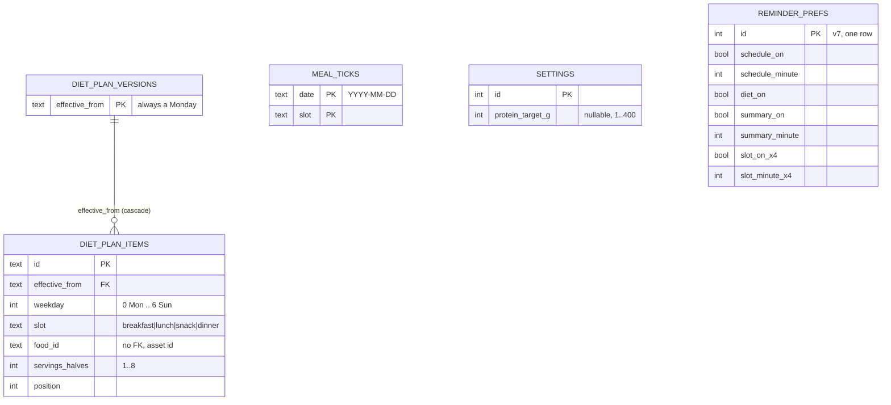
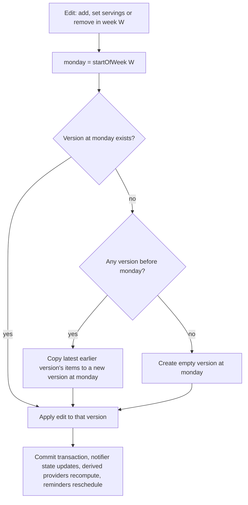
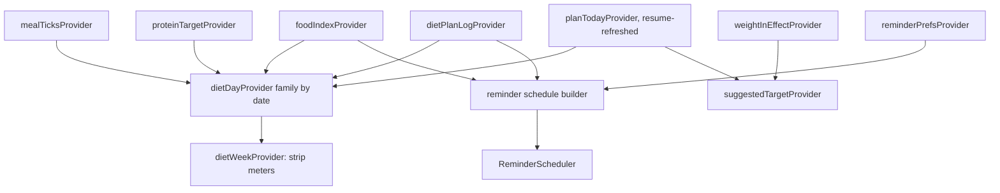
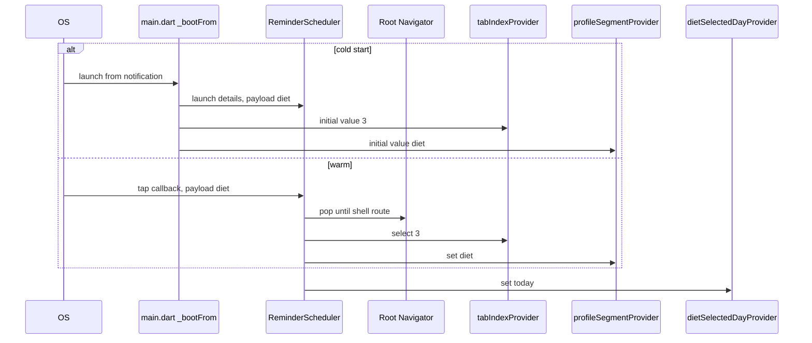
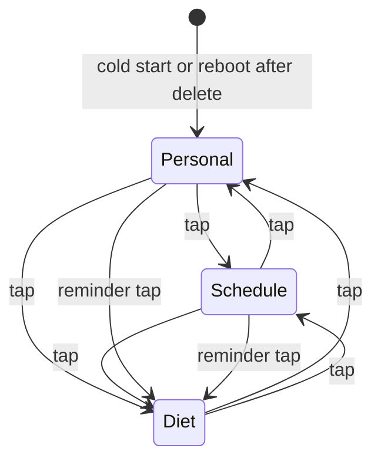
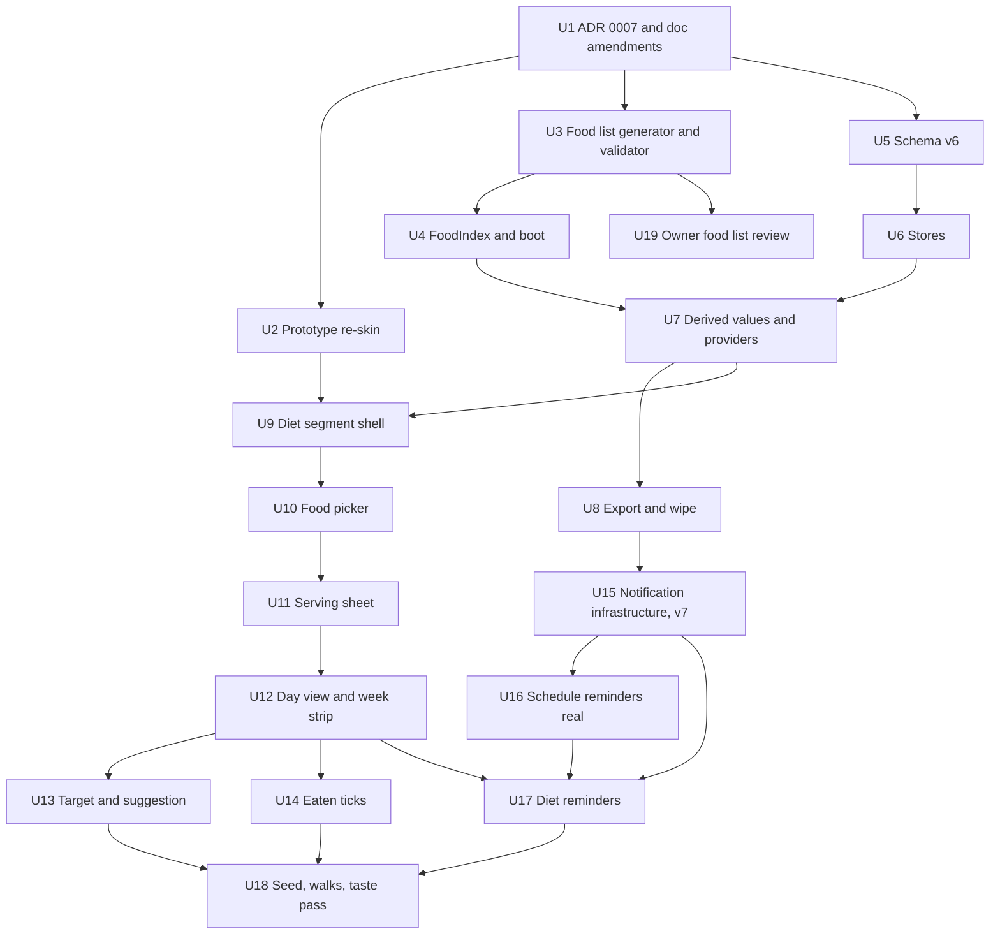

# Diet weekly protein plan in Profile - Plan

## Goal Capsule

- **Objective:** A lifter can plan a week of protein-rich meals from a reviewed offline food list in a few minutes, see each day's planned (and optionally eaten) protein against a daily target, and opt in to meal reminders, without the app becoming a calorie tracker or food diary.
- **Means:** a third Profile segment, Personal | Schedule | Diet (KD5, KTD1), backed by a bundled generated food list (KD4, KTD10), a dated weekly plan in Drift schema v6 (KTD5), derived-on-read totals (KTD13), and reminders built on the notification infrastructure U15 creates for ADR 0005, whose Remind me row is inert until then (KTD14, KTD15).
- **Authority:** `CLAUDE.md` hard rules, then `docs/01`-`04`, then `docs/00`, then this plan. `prototypes/` win on layout only. ADR 0007 (U1) is the record of the scope change; where this plan and ADR 0007 disagree, ADR 0007 wins once accepted.
- **Stop conditions:**
  - Stop before U3 if ADR 0007 is not written and the doc amendments in U1 are not in place. No diet code lands on an unamended `docs/01`.
  - Stop and report if the food list cannot be sourced from IFCT 2017 for a viable core (R6) rather than substituting another database.
  - Stop U15-U17 if the chosen notification plugin no longer ships a `Package.swift` in the resolved version (KTD14).
  - Stop if any unit would need a schema step numbered below the current version.
- **Execution profile:** phased vertical slices (see Phased Delivery). Data units are test-first. UI units prove each state with widget tests, then the taste-shots walk.
- **Who finishes:** an implementing agent runs U1-U18. The user reviews the food list after it is built (U19) and signs ADR 0007. No commits or pushes unless the user asks. Never run `dart format` over `lib/` or `test/`.

---

## Product Contract

### Summary

Diet becomes the third segment of the Profile tab. It holds one weekly plan of four meal slots per day, filled from a bundled list of Indian-first protein foods with IFCT 2017 values. Each day shows planned protein against a target the user types or accepts from a bodyweight-based suggestion, plus an optional one-tap "eaten" tick per slot. Opt-in reminders send a morning summary and one note per meal slot. Every total is computed on read; the database holds only what the user entered.

### Problem Frame

People who train often under-eat protein, do not know which everyday foods carry it, and quit diet apps because logging every meal takes too long (see `.claude/prds/diet-plan.prd.md` §Evidence). TurtleLift already records the training but says nothing about food, so users need a second app. `docs/01` §Not trying to be currently rules out "a nutrition app" and "logging food, daily totals", so the feature needs an approved scope change before it can be built (KD1).

### Key Decisions

- KD1. **Diet is an approved V1 scope change, narrowed to a protein-only weekly plan.** (session-settled: user-directed — chosen over keeping `docs/01`'s "not a nutrition app" line unchanged: the owner approved the feature as V1 scope.) Governs R1, R2, R3.
- KD2. **The optional "eaten" tick is built, not deferred.** (session-settled: user-directed — chosen over cutting or deferring the tick as the feature's closest brush with food logging: the owner wants plan-vs-eaten visible.) Governs R18, R19, R20.
- KD3. **The target suggestion is 1.6 g per kg of the bodyweight in effect today, rounded to the nearest 5 g, after verification against the primary sources.** (session-settled: user-directed — chosen over an unverified multiplier or a beginner/regular split: verified below, see Protein rule verification.) Governs R15, R16.
- KD4. **The full food list ships in the app, generated and validated like `exercises.json`, with an IFCT 2017 citation per food; the owner reviews it after it is built.** (session-settled: user-directed — chosen over a stub list to be filled later: the owner wants to review the real list.) Governs R5, R6, R7, R8.
- KD5. **Diet is a third Profile segment, Personal | Schedule | Diet, not a fifth tab.** (session-settled: user-directed — chosen over a fifth L0 tab as the prior plan recommended: keeps the four-tab ceiling in ADR 0004.) Governs R9, R10, R11, R12.

### Requirements

**Scope and documents**

- R1. ADR 0007 records the scope change, the Profile-segment placement, the placement-rule exception for diet figures, and the extension of ADR 0005's notification exception to diet reminders.
- R2. `docs/01` §Not trying to be, `docs/00` (§1, §2, §3, §11, §13), ADR 0004, ADR 0005 and `CLAUDE.md` (Generated data, Build order, Out of scope, Decided) are amended to match ADR 0007, each pointing to it.
- R3. Diet stays protein-only: no calories, carbs, fat, custom foods, free-form food logging, barcode, photos, recipes, AI plans, streaks or badges.
- R4. `prototypes/diet.html` is re-skinned to the repo's rules and the Profile-segment placement before UI work starts, so "prototype wins on layout" points at a correct layout.

**Food list**

- R5. `assets/foods/foods.json` ships in the app bundle, generated from Python source tables and checked by a validator that CI runs, with `git diff --exit-code` catching hand edits.
- R6. Every food cites an IFCT 2017 food code; foods IFCT 2017 does not cover are left out and listed for the owner's review rather than sourced elsewhere.
- R7. Every food has a stable id, name, aliases, diet type (`veg`, `egg`, `nonVeg`), household serving label, grams per serving and protein per serving to one decimal.
- R8. A food id, once shipped, is never removed or reused; the validator enforces this against a committed ledger.

**Placement and navigation**

- R9. The Profile tab's segmented control reads Personal | Schedule | Diet and fits on one line, with 48 pt tap targets, on the iPhone 17e at 1.3x text.
- R10. Profile opens on Personal on every cold start and after Delete all data; the chosen segment survives tab switches within a run.
- R11. A diet reminder tap, from a warm or cold start, lands on Profile with the Diet segment showing today, popping any pushed route first.
- R12. Inside the app, diet figures (planned, eaten, to go, meters) render only on Profile → Diet, never on History, the summary card or the share card; the reminder text in R22 is the one surface outside the app that carries gram figures. No workout figure renders on Diet.

**Plan and target**

- R13. One weekly plan holds Monday to Sunday with four slots each (Breakfast, Lunch, Snack, Dinner); each slot holds zero or more foods with a serving count from 0.5 to 4 in 0.5 steps.
- R14. Adding a food picks servings and "Repeat on" weekdays in one sheet; adding a food already in that slot on that day replaces its servings; removing a food offers undo instead of a confirmation dialog.
- R15. The daily protein target is one optional whole number from 1 to 400 g, typed or filled from the suggestion; accepting the suggestion stores the number, never a "follow bodyweight" flag.
- R16. The suggestion appears only when a bodyweight is in effect today, shows its working and its source, and links to Personal details when no bodyweight exists.
- R17. Each day shows planned protein, "to go" while planned is under target, and a planned-against-target bar only when a target exists; copy states counts, never verdicts ("behind", "missed", "failed", "over", "great job" never appear).

**Eaten ticks**

- R18. Each non-empty slot on today or an earlier day of the current week carries an optional eaten tick; future days and empty slots show no tick at all.
- R19. Eaten protein for a day is the planned protein of its ticked slots under the plan in effect that week, computed on read and shown beside planned, with a word or legend so it is never shown by colour alone.
- R20. A tick never changes, suppresses or adds a reminder.

**Reminders**

- R21. Diet reminders are opt-in: a master switch, a morning summary with a time, and one switch and time per slot; the first enable shows an explain-first sheet before any system prompt, and everything else works when permission is denied.
- R22. Reminders are built from the plan only: no reminder for an empty slot, no summary for a day with nothing planned, fixed template copy that never mentions what was or was not eaten.
- R23. Diet reminders ship only after the ADR 0005 notification infrastructure exists; until then no reminder control is shown on Diet.

**Data lifecycle**

- R24. Nothing derived is stored: planned, eaten, to go, meters, suggestion and reminder text are computed on read.
- R25. Export gains a `diet` key with the target, plan versions and ticks (entered data only, food names beside ids); Delete all data empties every diet table and cancels every scheduled notification.

**Errors and visuals**

- R26. If the food list fails to load, Diet shows a plain unavailable state and every other tab keeps working; a plan row whose food id is unknown renders as "Unknown food", counts 0 g and can be removed.
- R27. Diet UI uses palette roles only (no new colours), sentence case, nothing under 12 pt, one filled button per view, outlined selection controls, a shape-plus-word diet-type marker, and a medical disclaimer on the target screen.

### Acceptance Examples

- AE1. **Covers R17.** Given a 120 g target and 86 g planned on Wednesday, when Wednesday is selected, the day card reads "86 of 120 g planned" with "34 g to go"; at 120 g planned it reads "120 of 120 g planned" with no "to go" line.
- AE2. **Covers R17.** Given no target, the day card reads "86 g planned" with a "Set a daily target" link and no bar.
- AE3. **Covers R18, R19.** Given today is Wednesday, Monday's lunch is ticked and Friday has food, Monday's card shows "28 g eaten", and Friday's slots show no tick control.
- AE4. **Covers R14.** Given paneer bhurji at 1 katori in Wednesday lunch, adding it again at 2 katori with Repeat on Mon-Fri leaves exactly one paneer row per day at 2 katori.
- AE5. **Covers R15, R16.** Given a bodyweight of 72 kg in effect today, the target screen offers "Suggested 115 g" (1.6 × 72 = 115.2, nearest 5 is 115); tapping it fills the field and saves nothing until Save.
- AE6. **Covers R11.** Given the app is cold-started by tapping the 13:00 lunch reminder, the first frame after boot is Profile with Diet selected and today's day card.
- AE7. **Covers R22, R20.** Given Thursday has no snack planned and Thursday lunch is already ticked, Thursday schedules no snack reminder and still schedules the lunch reminder.
- AE8. **Covers R10.** Given the user is on Diet and taps Delete all data, after the reboot Profile shows Personal and Diet shows its first-time empty state.

### Success Criteria

- A seeded widget test plans 4 slots × 7 days in 12 or fewer sheet commits (Repeat on proves "a few minutes once a week").
- The taste-shots walk captures every Diet state on the iPhone 17e and 17 Pro Max with no clipped text at 1.3x and no turtle-taste FAIL.
- The owner signs ADR 0007 and approves the food list in U19.

### Scope Boundaries

**Deferred for later**

- Different plans for training and rest days, or training-day markers on the week strip.
- A "last week" view; past weeks stay stored and exported but are not shown.
- A "Mark eaten" action on the notification (needs a background isolate writing the database).
- Planning "from next week": edits always apply from this week's Monday, so a Sunday re-plan also changes this week's earlier eaten totals (A5).
- Folding the diet screens into `prototypes/screens.html` (PRD milestone 3); this plan re-skins `prototypes/diet.html` in place.
- The turtle mascot on Diet (last thing built, decided with the user).
- Foods IFCT 2017 does not cover (whey, branded products, tofu if absent); collected in U19 for a later decision.

**Outside this product's identity**

- Calorie, carb, fat or macro tracking; free-form food logging; custom foods; online food databases; barcode, photos, recipes; AI meal plans; shopping lists; supplements; clinical or allergy diets; diet streaks or badges; behaviour-reactive notifications.

**Deferred to Follow-Up Work**

- Inter typeface bundling stays undecided (`CLAUDE.md`); Diet uses the platform font.
- Any colour for diet types (the Indian green/red dot) stays out unless the owner changes the palette spec.

### Sources

- Drafts: `docs/06-diet-tab-userflow.md`, `prototypes/diet.html`, `.claude/prds/diet-plan.prd.md`, and the prior integration plan `docs/plans/diet-integration-plan.md`, whose user stories, data model and test lists this plan carries forward, re-based on a Profile segment.
- Morton RW et al. 2018, Br J Sports Med 52:376-384, doi:10.1136/bjsports-2017-097608, PMID 28698222, PMCID PMC5867436. https://pubmed.ncbi.nlm.nih.gov/28698222/ and https://pmc.ncbi.nlm.nih.gov/articles/PMC5867436/
- Jäger R et al. 2017, "International Society of Sports Nutrition Position Stand: protein and exercise", JISSN 14:20, doi:10.1186/s12970-017-0177-8, PMID 28642676, PMCID PMC5477153. https://pubmed.ncbi.nlm.nih.gov/28642676/ and https://pmc.ncbi.nlm.nih.gov/articles/PMC5477153/
- Longvah T et al., Indian Food Composition Tables 2017, National Institute of Nutrition (ICMR), Hyderabad.
- `flutter_local_notifications` 23.0.0 (pub.dev, published 2026-11-06) and `flutter_timezone` 5.1.1: both published archives contain `ios/<plugin>/Package.swift`.

---

## Planning Contract

### Key Technical Decisions

- KTD1. **Diet is `ProfileSegment.diet` rendered by a new `DietPane` inside `ProfileRoot`'s existing `ListView`.** No `L0Tab` insertion, no `kL0TabCount` change, no `GlassTabBar` change; Profile stays index 3, so `GlassTabBar.itemKey(3)` in `test/l0_shell_test.dart` and `integration_test/taste_shots_test.dart` stays correct. Inherits KD5; governs R9, R12.
- KTD2. **The segment moves from `_ProfileRootState` to an in-memory `profileSegmentProvider` (`Notifier<ProfileSegment>`), never stored.** A notification tap must switch it from outside the widget, which local `State` cannot do. It builds to `personal`, so a cold start and the `appRestartProvider` reboot after Delete all data both reset it (R10). The `ProfileRoot` doc comment that says "nothing outside this widget needs to switch it" is rewritten.
- KTD3. **Switching segment jumps the shared scroll view to the top.** The three panes share one `ListView`; Diet is the longest pane, and without a reset a switch from a scrolled Diet lands mid-way down Personal. A `ScrollController` owned by `ProfileRoot` calls `jumpTo(0)` on change.
- KTD4. **Diet controls live in the pane, not the header.** `L0TabSpec.actions` is per tab, so a bell would show on Personal and Schedule too. Diet gets a "Target" row and, once U17 lands, a "Reminders" row, matching Schedule's in-pane Remind me row.
- KTD5. **The plan is a dated series of whole-week versions keyed by Monday, written copy-on-write.** `DietPlanVersions(effectiveFrom PK)` plus `DietPlanItems`. An edit in week W copies the latest version before `monday(W)` into a new version at `monday(W)` if none exists, then applies the edit, in one transaction; no path writes an older version. Same guarantee and Monday rule as `TrainingPlanStore` (ADR 0005 §2, commit 41470c0). Weekdays are **0 = Monday to 6 = Sunday**, matching `TrainingPlanEntry`, not the 1-7 the prior plan proposed.
- KTD6. **Servings are stored as an integer count of halves, 1 to 8, with a CHECK.** No float drift; 0.5 to 4 by construction. One row per `(effectiveFrom, weekday, slot, foodId)` via a UNIQUE constraint, so a repeat add replaces (R14). Slot is stored by name with a CHECK on the four names.
- KTD7. **The target is one nullable integer column on `Settings` with `CHECK (protein_target_g IS NULL OR protein_target_g BETWEEN 1 AND 400)`, not a dated series.** No screen shows past weeks, so a series buys nothing visible; null means "never set", the `bodyGender` convention.
- KTD8. **Ticks are `MealTicks(date, slot)` with a composite primary key; presence means eaten, untick is a hard delete.** The store rejects a date after today or before this week's Monday (a CHECK cannot see "today"), and a test proves it.
- KTD9. **`DietPlanItems.foodId` has no foreign key.** The food list is an asset, as template ids are Dart consts (`Sessions.templateId` precedent). R8's ledger keeps old ids resolvable; R26 covers a miss defensively. Protein per serving is not snapshotted on plan rows: a corrected value should flow into the plan, and unlike `loadType` it does not invert a meaning.
- KTD10. **The food list generator holds IFCT 2017 per-100 g edible-portion protein, the IFCT food code, and grams per household serving; protein per serving is computed at generation time to one decimal.** Inherits KD4. Cooked dishes are expressed through their main raw ingredient with the serving label naming the cooked form (for example "1 katori cooked dal, 30 g dry"), because IFCT 2017 tabulates raw foods. The validator also emits `foods.csv` for the owner's review, as `validate_exercise_library.py` emits `exercises.csv`.
- KTD11. **The food list loads at boot beside the exercise library, but a load or parse failure yields an unavailable `FoodIndex` instead of failing boot.** The failure is reported through `FlutterError.reportError` (visible in debug, non-throwing, so tests can exercise the fallback) and Diet shows R26's state. The exercise library keeps its fail-loud behaviour.
- KTD12. **Suggestion = `roundToNearest5(1.6 × weightInEffectOn(today).weightKg)`, halves rounding up, null without a bodyweight.** Inherits KD3; verified in Protein rule verification. Reads `weightInEffectProvider`; never stored.
- KTD13. **Every visible diet number comes from pure functions in `lib/src/data/diet_derived.dart` behind computed providers; "today" refreshes on app resume.** `planTodayProvider` is a plain `Provider` read once, so an app left open past midnight shows yesterday as today. It becomes a resume-refreshed clock (an `AppLifecycleListener` invalidates it on `resumed`), which also fixes the Schedule pane. Stores never take "this week" from a cached provider: `DietPlanStore` and `MealTickStore` take an injectable `today` function (default `LocalDate.today`, which has no seam of its own) and every write computes `monday` from it at write time, so an app left open from Sunday into Monday cannot write into last week's version (KTD5's guarantee).
- KTD14. **Notifications use `flutter_local_notifications` ^23.0.0 with `flutter_timezone` ^5.1.1 (and its `timezone` dependency).** Both published archives ship `ios/<plugin>/Package.swift`, verified on 2026-11-08; 23.0.0 needs Flutter ≥ 3.44 and the repo runs 3.47.4. Android needs core-library desugaring in `android/app/build.gradle.kts`, `POST_NOTIFICATIONS`, `RECEIVE_BOOT_COMPLETED` and the plugin's boot receiver, and `AndroidScheduleMode.inexactAllowWhileIdle`, so no exact-alarm permission is requested (ADR 0005 Consequences).
- KTD15. **Reminders are weekly-repeating notifications (`matchDateTimeComponents: dayOfWeekAndTime`), one per weekday per kind, rescheduled in full on any change.** The plan repeats weekly, so a weekly trigger needs no app open to stay current, unlike a rolling window that stops after 7 days unopened. Budget: 7 training + 7 summaries + 28 meals = 42, under iOS's 64 pending. IDs are deterministic ranges (training 100-106, diet summary 200-206, diet meal 300 + weekday × 10 + slot). "Reschedule" means cancel the feature's range, then schedule from current state; it runs after every plan or preference change, at boot and on resume, and is idempotent.
- KTD16. **A `ReminderScheduler` interface behind a provider wraps the plugin; tests override it with a recording fake.** Widget and unit tests never touch the platform channel, the same seam `appDatabaseProvider` gives the database.
- KTD17. **A reminder tap carries a target payload, `diet/today` (Schedule reminders use `schedule`), never a tab index; the handler pops to the shell route, selects tab 3, sets `profileSegmentProvider` to `diet` and the selected day to today.** Cold start reads the launch details once in `main()`, before the first `_bootFrom`, and passes the payload to that boot only; the `appRestartProvider` reboot calls `_bootFrom` with no payload, because the plugin returns the same launch details for the life of the process and would otherwise re-seed Diet after Delete all data (R10, AE8). The pop predicate is the shell route, not `isFirst` (see `TurtleLiftApp`'s comment).
- KTD18. **Reminder preferences live in one new single-row table `ReminderPrefs` at schema v7, pinned like `Settings`.** It holds the Schedule reminder (`on`, `minute`) and the diet reminders (master, summary on/minute, four slot on/minute), with `CHECK (minute BETWEEN 0 AND 1439)` on every minute. A separate table rather than more `Settings` columns keeps reminder state wipeable and testable as one unit, and avoids growing the row whose legacy columns cannot be dropped. If the ADR 0005 ticket lands its own storage first, the diet columns take the next version above it.
- KTD19. **Export adds a top-level `diet` key and keeps `kExportFormatVersion` at 1.** Adding a key is not a rename or removal (`data_export.dart` doc).
- KTD20. **Palette by role, no new colours.** Eaten layer, tick-on and legend swatch use `accentStrong` (active/done). Planned layer and week meters use `textMuted` on `mutedSurface`. Diet-type glyph and serving meta use `textSecondary`/`textMuted`. Remove uses `danger` as text only. `accentLight` is not used (secondary muscle only). The one primary action per view uses the app's `FilledButton` theme, whatever the palette work in progress renders it as. `test/theme_palette_test.dart` must still pass.
- KTD21. **Diet figures are a second named exception to ADR 0004's placement rule.** They are derived yet live on Profile, justified as the feedback loop for a plan the user just typed, like the Schedule week summary; the same figure must never render on History. Reminder bodies (R22) are the only other place gram figures appear. Recorded in ADR 0007.

### High-Level Technical Design

**Data model (schema v6, plus v7 for reminder preferences)**

**Copy-on-write edit in week W**

**Provider graph (derived on read)**

**Reminder tap to Diet**

**Profile segment states**

### Profile segment evaluation

**Verdict: workable. Diet goes in Profile as decided (KD5); each concern below has a mitigation or an accepted cost.**

| Concern | Finding | Mitigation |
|---|---|---|
| Segmented control width on iPhone 17e at 1.3x | The control is three `Expanded` capsules in the gutter. At 390 pt wide minus 32 pt gutter and 6 pt padding, each segment is about 117 pt. "Personal" (the longest label) at 12.5 pt × 1.3 is about 70 pt wide, and the fixed 38 pt row height holds a 16 pt line. It fits with room. | The control is about 44 pt tall today (38 pt row plus 3 pt padding), short of R9's 48 pt, so U9 grows the row to 42 pt. A widget test pumps at 375 pt width and 1.3x text and asserts no overflow, single-line labels and a 48 pt tap target per segment (U9). |
| Notification deep link | Today the segment is local `State`, so nothing outside can select Diet. | KTD2 moves it to an in-memory provider; KTD17 routes warm and cold taps. |
| Pinned header | The header is `AppScreen.root` in `L0Shell`, titled "Profile" for all segments; the segmented control scrolls with the body, which `test/app_screen_test.dart` allows. A Diet-only header action is impossible without making the shell segment-aware. | KTD4: Diet controls are in-pane rows. Header stays "Profile". |
| Segment state in memory vs restored | Restoring would surprise a user opening the app to log a set and finding Diet; ADR 0004's Profile opens on Personal. | In memory only; a reminder tap is the one outside entry (R10, R11). |
| Shared scroll offset | One `ListView` for three panes of very different length. | KTD3 jumps to top on switch. |
| Bodyweight feeding the suggestion | Bodyweight is recorded in `PersonalDetailsScreen`, pushed from Personal. | The target screen's "Add your bodyweight" link pushes `PersonalDetailsScreen` directly on top of it, so Back returns to the target screen and the suggestion appears, recomputed from `weightInEffectProvider`. |
| Discoverability | A daily surface sits behind a tab and a segment, used 3-4 times a day with reminders. | Accepted cost. The segment label is visible on every Profile open; reminders deep-link straight in; the Workout tab gets no diet entry (ADR 0006 keeps it exercise-first). Revisit with testers (Open Questions). |
| Placement rule | Profile is "authored"; diet totals are derived. | KTD21 names the exception in ADR 0007. |

### Protein rule verification

**Result: the rule is correct as a point estimate and is used as decided (KD3, KTD12).** Verified from the primary sources on 2026-11-08:

- Morton et al. 2018 abstract: "Protein supplementation beyond total protein intakes of 1.62 g/kg/day resulted in no further RET-induced gains in FFM", concluding "protein intakes at amounts greater than ~1.6 g/kg/day do not further contribute RET-induced gains in FFM." The full text gives the breakpoint as 1.62 g/kg/day with 95% CI 1.03 to 2.20, from 42 study arms (723 participants), and notes the segmental regression was not statistically significant (p = 0.079). The authors add that "it may be prudent to recommend ~2.2 g protein/kg/d for those seeking to maximise" gains.
- Jäger et al. 2017 (ISSN position stand): "an overall daily protein intake in the range of 1.4-2.0 g protein/kg body weight/day (g/kg/d) is sufficient for most exercising individuals" for building and maintaining muscle mass.
- 1.6 g/kg sits inside the ISSN range and on Morton's point estimate. Both papers use total body weight, which `BodyweightEntries` stores.

Caveats carried into the UI copy (U13): the suggestion is framed as "a common starting point", not an optimum. The source note names both papers and the 1.4-2.0 g/kg range so a user who wants more knows the range exists. The medical disclaimer stays. The rule is applied to total body mass with no cap (see Assumptions).

### Assumptions

These are defaults taken without the owner, because this run had no one to ask. Each is a bet the owner can overturn.

- A1. The Egg chip means veg plus egg ("eggetarian"); Veg means veg only; Non-veg means non-veg foods only. The chip caption reads "Veg and egg foods".
- A2. One plan for every week; no training-day markers on the week strip.
- A3. Target bounds are 1 to 400 g; the target is one value, not a dated series (KTD7).
- A4. The dated plan series is kept though no screen shows past weeks (export uses it).
- A5. Editing an earlier day this week changes that day's eaten total, because eaten is plan × ticks; the prototype's "never rewrites what you ticked" line is dropped.
- A6. No custom foods and no notification "Mark eaten" action in V1.
- A7. Default reminder times: summary 07:30, Breakfast 08:00, Lunch 13:00, Snack 17:00 (off by default), Dinner 20:30. Slot headers show no time unless that slot's reminder is on.
- A8. The Schedule pane's Remind me row becomes real in U16, as the first consumer of the notification infrastructure, if the ADR 0005 ticket has not already done it.
- A9. The explain-first sheet shows on the first enable of each feature (Schedule, Diet); the OS prompt appears only while permission is undetermined.
- A10. The food list is limited to foods IFCT 2017 covers, targeting at least 100 foods: at least 60 veg, at least 25 non-veg and every IFCT egg entry, enforced as validator minimums.
- A11. The owner is the post-build reviewer of the food list and fills `reviewedBy` (U19). Until then the field reads `pending-owner-review`, and the validator allows that value.
- A12. The suggestion uses total body mass with no cap; for a very heavy user it may read high, which the disclaimer and the "starting point" framing cover.
- A13. Removing a food shows a 4-second undo snackbar; no confirmation dialog (that is for workouts and all data).
- A14. `prototypes/diet.html` is re-skinned in place with CSS variables named after `AppPalette` roles, not hexes, so the parallel palette change does not stale it again.
- A15. Search matches name and aliases, ignoring case and diacritics; rows sort by protein per serving, highest first, then by name. The chip choice lasts for the run only.

### Open Questions

**Deferred (none blocks implementation)**

- Is Diet discoverable enough behind Profile? Watch testers; promoting it to a tab later is a new ADR, and KTD1 keeps that move cheap because the pane does not depend on being in Profile.
- Do testers want training-day markers or a training/rest split (A2)?
- Which IFCT-absent foods (U19 list) should be admitted, and from what source?

### System-Wide Impact

- **Navigation:** no tab change; `ProfileRoot` gains a provider-backed segment and a scroll controller. ADR 0003's single-navigator invariant holds because a reminder tap pops to the shell before switching tabs.
- **Data lifecycle:** three new tables and one column at v6, one table at v7; export and wipe cover all of them; the wipe test iterates `database.allTables` so a future table cannot dodge it.
- **Boot:** `_bootFrom` gains the food list, plan, ticks, target and launch-details reads in its parallel record; the food list read is failure-tolerant (KTD11).
- **Platform config:** Android Gradle desugaring and manifest entries, iOS notification setup through Swift Package Manager only.
- **Shared widgets:** `_DayChip`/`PlanDot` and `_SwitchRow`/`_Switch`/`_TimeRow`/`_ExplainSheet` move out of `schedule_pane.dart` into shared files used by Schedule and Diet; `StepperField` gains a `min`.
- **Today:** the resume-refreshed clock (KTD13) changes Schedule's behaviour across midnight too, for the better.

### Risks & Dependencies

| Risk | Mitigation |
|---|---|
| Wrong protein values mislead users | IFCT code and a serving source per food (gram weights are half of every figure and IFCT has no household measures), validator ranges (protein ≤ grams, > 0), owner review (U19), "reviewed copy, never hand-edit" rule in `CLAUDE.md` |
| IFCT 2017 is a printed or PDF table, not an API, so values are typed into the generator by hand | Each row carries the IFCT code and page so a reviewer can check it; `foods.csv` is the review sheet |
| Cooked household servings do not exist in IFCT | KTD10 raw-weight equivalence, stated in the serving label |
| Scope creep into calories or logging | R3 and ADR 0007 name the cuts |
| Notifications blocked on unbuilt ADR 0005 work | U15-U16 build it; R23 hides the Diet control until then |
| Plugin drops `Package.swift` or raises its Flutter floor | KTD14 pins ^23.0.0; stop condition in the Goal Capsule |
| iOS 64-pending cap | KTD15 budget of 42 |
| Midnight rollover shows the wrong today | KTD13 |
| A table added without export and wipe | `allTables`-driven wipe test (U8) |
| Schema numbering collision with the ADR 0005 ticket | KTD18: whichever lands first takes 7, the other goes above |
| Users read the target as medical advice | Disclaimer and "starting point" copy (U13) |
| Discoverability behind Profile | Accepted; tester check (Open Questions) |
| A reminder tap while logging pops the stack and drops unsaved "+ Add set" rows held in local state | Accepted: set values commit on change and the open session is the Workout root, so the session survives |
| The header and its semantics label read "Profile" while Diet shows | Accepted; the selected segment is announced by its own semantics |

### Phased Delivery

- **Phase A, decide (U1-U2):** paper only. Gate for everything else.
- **Phase B, food list (U3-U4):** nothing visible; CI green with the new generator.
- **Phase C, data (U5-U8):** every table ships with export and wipe in the same phase.
- **Phase D, UI (U9-U14):** each unit leaves Diet usable; U9 alone already shows the empty state.
- **Phase E, reminders (U15-U17):** U15-U16 are the ADR 0005 prerequisite; if they slip, Diet ships without a reminder row (R23).
- **Phase F, finish (U18-U19).**

---

## Implementation Units

| U-ID | Title | Key files | Depends on |
|---|---|---|---|
| U1 | ADR 0007 and doc amendments | `docs/adr/0007-diet-in-profile.md`, `docs/01-app-idea.md`, `docs/00-build-spec.md`, `CLAUDE.md` | none |
| U2 | Re-skin the diet prototype | `prototypes/diet.html` | U1 |
| U3 | Food list generator, validator, CI | `assets/foods/*`, `pubspec.yaml`, `.github/workflows/ci.yml` | U1 |
| U4 | FoodIndex and boot loading | `lib/src/data/food_index.dart`, `lib/main.dart` | U3 |
| U5 | Schema v6 and migration | `lib/src/data/app_database.dart` | U1 |
| U6 | Diet stores | `lib/src/data/diet_plan_store.dart`, `lib/src/data/meal_ticks.dart` | U5 |
| U7 | Derived values, providers, resume clock | `lib/src/data/diet_derived.dart`, `lib/src/data/diet_plan.dart`, `lib/src/data/training_plan.dart` | U4, U6 |
| U8 | Export and Delete all data | `lib/src/data/data_export.dart`, `lib/src/data/data_reset.dart` | U7 |
| U9 | Diet segment shell | `lib/src/ui/profile_root.dart`, `lib/src/ui/diet_pane.dart` | U2, U7 |
| U10 | Food picker screen | `lib/src/ui/food_picker_screen.dart` | U9 |
| U11 | Serving sheet | `lib/src/ui/food_serving_sheet.dart`, `lib/src/ui/stepper_field.dart` | U10 |
| U12 | Day view and week strip | `lib/src/ui/diet_day_card.dart`, `lib/src/ui/diet_slot_card.dart`, `lib/src/ui/week_day_chip.dart` | U11 |
| U13 | Target screen and suggestion | `lib/src/ui/protein_target_screen.dart` | U12 |
| U14 | Eaten ticks | `lib/src/ui/diet_slot_card.dart`, `lib/src/ui/diet_day_card.dart` | U12 |
| U15 | Notification infrastructure and schema v7 | `lib/src/data/reminder_scheduler.dart`, `lib/src/data/reminder_prefs.dart`, Android and iOS config | U8 |
| U16 | Schedule reminders made real | `lib/src/ui/schedule_pane.dart`, `lib/src/ui/reminder_controls.dart` | U15 |
| U17 | Diet reminders | `lib/src/ui/diet_reminders_screen.dart`, `lib/src/data/diet_reminders.dart` | U12, U15, U16 |
| U18 | Debug seed, walks, taste pass | `lib/src/data/sample_history_seed.dart`, `integration_test/*` | U13, U14, U17 |
| U19 | Owner review of the food list | `assets/foods/foods.csv` | U3 |

### U1. ADR 0007 and doc amendments

- **Goal:** record the scope change and placement so no diet code lands on unamended rules.
- **Requirements:** R1, R2, R3, R12; KD1-KD5; KTD21.
- **Dependencies:** none.
- **Files:** create `docs/adr/0007-diet-in-profile.md`; modify `docs/01-app-idea.md` (§Not trying to be, §App structure, §Out of scope), `docs/00-build-spec.md` (§1 shipped files, §2 data model, §3 derived values, §11 placement exception, §13 out of scope), `docs/adr/0004-profile-returns-as-a-tab.md` (Status line and Consequences: third segment, second named exception), `docs/adr/0005-schedule-and-opt-in-notifications.md` (Status: exception extended to diet reminders under the same five rules), `CLAUDE.md` (Generated data table gains `assets/foods/foods.json` as reviewed nutrition copy; Build order gains the diet step after Profile/Schedule and before the mascot; Out of scope narrows "nutrition" to "calorie, macro or food-diary tracking"; Decided in session gains the Profile-segment entry), `docs/06-diet-tab-userflow.md` and `.claude/prds/diet-plan.prd.md` (status lines: accepted, placement superseded by ADR 0007).
- **Approach:**
  1. Write ADR 0007 in the 0004/0005 shape: Context (PRD evidence), Decision (protein-only plan, Profile segment, eaten tick, reminders), why 0003's invariant is untouched, Consequences (placement exception per KTD21, notification extension, schema v6/v7, the food list as reviewed content, the protein rule and its two citations).
  2. Amend each doc with a pointer to ADR 0007, not a restatement.
  3. Narrow `docs/01` to: not a calorie or macro tracker, not a food diary; a protein-only weekly plan is in scope (ADR 0007).
- **Patterns to follow:** `docs/adr/0004-profile-returns-as-a-tab.md`, `docs/adr/0005-schedule-and-opt-in-notifications.md` (Status line style, "Why this does not reopen 0003").
- **Test expectation:** none -- documentation only.
- **Verification:** every amended doc names ADR 0007; `docs/01`, `docs/00` §13 and `CLAUDE.md` no longer contradict a protein plan with a daily total; no doc still says "fifth tab" for Diet.

### U2. Re-skin the diet prototype

- **Goal:** make `prototypes/diet.html` a correct layout reference for a Profile segment under the repo's rules.
- **Requirements:** R4, R27; KTD4, KTD20.
- **Dependencies:** U1.
- **Files:** modify `prototypes/diet.html`.
- **Approach:**
  1. Replace the five-tab bar with the four-tab glass bar and Profile selected; put the Personal | Schedule | Diet control at the top of the scroll body under a pinned "Profile" header (`position: sticky`, as `screens.html` does).
  2. Remove the Inter Google Fonts link (platform font), raise every caption to 12 px or more, make every label sentence case, and replace em dashes in copy.
  3. Map colours to CSS variables named after `AppPalette` roles (A14); outline the tick, chips and day chips; one filled button per view.
  4. Move the bell into an in-pane "Reminders" row and add a "Target" row (KTD4).
- **Patterns to follow:** `prototypes/schedule-options.html` (`.seg`), `prototypes/screens.html` sticky header.
- **Test expectation:** none -- static prototype.
- **Verification:** opened in a browser, every D1-D4 state renders inside a Profile frame with no text under 12 px and no uppercase tracked labels.

### U3. Food list generator, validator, CI

- **Goal:** ship a complete, reviewed-ready `foods.json` that CI proves regenerates byte for byte.
- **Requirements:** R5, R6, R7, R8; KD4; KTD10.
- **Dependencies:** U1.
- **Files:** create `assets/foods/food_catalogue.py` (shared constants: diet types, serving units), `assets/foods/foods_dairy.py`, `assets/foods/foods_pulses.py`, `assets/foods/foods_grains_nuts.py`, `assets/foods/foods_egg.py`, `assets/foods/foods_meat_fish.py` (source rows), `assets/foods/validate_food_catalogue.py` (validates and emits), `assets/foods/foods.json`, `assets/foods/foods.csv`, `assets/foods/food_ids_ever.csv` (one `id,dietType` row per shipped food); modify `pubspec.yaml` (asset entry with a comment like the exercises one), `.github/workflows/ci.yml` (a "Food list" step in `generated-data` before the drift check).
- **Approach:**
  1. Source rows carry `id`, `name`, `aliases`, `dietType`, `ifctCode`, `ifctPage`, `proteinPer100g`, `servingLabel`, `gramsPerServing`, `servingSource` (where the household measure and any cooked-to-dry yield come from: a named portion-size reference, or `owner estimate`), `reviewedBy`.
  2. The validator computes `proteinPerServingG` to one decimal (KTD10), then fails on: duplicate id or name; id not lower-case-hyphen; missing field; `dietType` outside the enum; `proteinPer100g` ≤ 0 or > 100; protein per serving > grams per serving; empty `ifctCode`; any id in `food_ids_ever.csv` missing from the rows (R8); a ledger id whose `dietType` changed (the ledger records `id,dietType`, so a filter cannot silently move a food); a total under 100 foods or diet-type counts under A10's minimums; an empty `servingSource`.
  3. It appends new ids to the ledger only when run with an explicit flag, so CI never rewrites it, and emits sorted, stable JSON and CSV.
  4. Foods IFCT 2017 lacks are listed in a `NOT_IN_IFCT` constant with a one-line reason, printed by the validator and carried to U19, never emitted.
- **Execution note:** write the validator's failure cases first against a tiny fixture, then fill the source tables.
- **Patterns to follow:** `assets/exercises/validate_exercise_library.py` (validate-and-emit, CSV beside JSON), `assets/exercises/content_*.py` (one module per family), the `generated-data` job in `.github/workflows/ci.yml`.
- **Test scenarios:**
  - A fixture row with protein per serving above its grams fails with a message naming the id.
  - A fixture missing an id that the ledger lists fails with "removed id".
  - A fixture with `dietType: "vegan"` fails.
  - Two rows with one id fail; two rows differing only in case of name fail.
  - The real tables pass, emit the A10 minimum counts, and a second run produces byte-identical `foods.json` and `foods.csv`.
- **Verification:** the CI `generated-data` job passes with the new step; `git diff --exit-code` is clean after regeneration; the validator prints the `NOT_IN_IFCT` list.

### U4. FoodIndex and boot loading

- **Goal:** expose the food list to the app through a provider, tolerating a bad asset.
- **Requirements:** R7, R26; KTD11; A1, A15.
- **Dependencies:** U3.
- **Files:** create `lib/src/data/food.dart` (model, `DietType`, `MealSlot`), `lib/src/data/food_index.dart` (`FoodIndex`, `foodLibraryProvider`, `foodIndexProvider`); modify `lib/main.dart` (`_bootFrom` record and override); create `test/food_index_test.dart`; modify `test/shipped_data_test.dart`, `test/boot_test.dart`.
- **Approach:**
  1. `FoodIndex` offers `byId`, `search(query, filter)` and the A15 sort; filter semantics per A1.
  2. Boot loads the asset in the same parallel record as the exercise library; on any exception it overrides with `FoodIndex.unavailable()` and reports the error without throwing (KTD11).
- **Patterns to follow:** `lib/src/data/exercise_library.dart`, `lib/src/data/exercise_index.dart`, `exerciseIndexProvider` override in `lib/main.dart`.
- **Test scenarios:**
  - Search "dahi" finds curd through its alias; "PANEER" matches "Paneer"; a query with a diacritic matches its plain form.
  - Filter Egg returns veg and egg foods and no non-veg; Veg returns no egg; Non-veg returns only non-veg.
  - Results sort by protein per serving descending, ties by name.
  - `byId` of an unknown id returns null.
  - Malformed JSON yields an unavailable index without throwing, under `flutter test` (asserts on), and the error is reported.
  - Shipped asset: parses, ids unique, every food has an IFCT code, counts meet A10.
- **Verification:** boot test passes with the real asset and with a broken asset stub; other tabs render in the broken case.

### U5. Schema v6 and migration

- **Goal:** add diet storage without touching existing rows.
- **Requirements:** R13, R15, R18, R24; KTD5-KTD9.
- **Dependencies:** U1.
- **Files:** modify `lib/src/data/app_database.dart` (tables, `schemaVersion` 6, `if (from < 6)` step, class doc comment), regenerate and commit `lib/src/data/app_database.g.dart`; modify `test/app_database_migration_test.dart`.
- **Approach:**
  1. Add `DietPlanVersions`, `DietPlanItems` (cascade on version delete, CHECKs and UNIQUE per KTD6), `MealTicks`, and `Settings.proteinTargetG` (KTD7).
  2. The step is pure DDL guarded by range: create three tables, add one column. It is idempotent in one transaction, per the doc comment's rule.
  3. Dates use `LocalDateConverter` text, as `Sessions.performedOn` does.
- **Execution note:** test-first: write the v5 → v6 upgrade test against a real v5 file before the step.
- **Patterns to follow:** the `from < 4` training-plan step and its tests; `TrainingPlanEntries.customConstraints`.
- **Test scenarios:**
  - A real v5 database with a session, bodyweight row, plan entry and settings row upgrades to v6 and keeps every row.
  - Upgrading from v1 reaches v6 without a duplicate-column error.
  - A fresh install creates every table including the three diet tables.
  - `servings_halves` 0 and 9 are rejected; slot `brunch` is rejected; weekday 7 is rejected.
  - A duplicate `(effective_from, weekday, slot, food_id)` is rejected.
  - Deleting a version cascades its items.
  - `protein_target_g` 0 and 401 are rejected; null is accepted.
  - A tick date round-trips as the same calendar day.
- **Verification:** migration suite green; `dart run build_runner build` leaves no diff.

### U6. Diet stores

- **Goal:** a store API that enforces copy-on-write and the tick window.
- **Requirements:** R13, R14, R15, R18; KTD5, KTD6, KTD8.
- **Dependencies:** U5.
- **Files:** create `lib/src/data/diet_plan_store.dart` (`DietPlanStore`: `readVersions`, `addFood(weekdays, slot, foodId, halves)`, with the week derived inside the store from its injected clock, `setServings`, `removeItem`, `restoreItem` for undo), `lib/src/data/meal_ticks.dart` (`MealTickStore`: `read`, `toggle`); modify `lib/src/data/settings_store.dart` (read and write target); create `test/diet_plan_store_test.dart`, `test/meal_ticks_test.dart`; modify `test/settings_store_test.dart`.
- **Approach:** every write is one transaction that first ensures the version at `monday(today())` per KTD5, `today` being the store's injected clock; `addFood` across N weekdays is one transaction (R14); `restoreItem` re-inserts the removed row into the current week's version.
- **Patterns to follow:** `TrainingPlanStore` in `lib/src/data/training_plan.dart`; `PersonalDetailsStore` row pinning.
- **Test scenarios:**
  - Editing in week W with only a version at W-2 creates a version at W holding W-2's items plus the edit, and W-2 is unchanged.
  - Two edits in the same week touch one version.
  - Adding to Mon-Fri writes five rows in one transaction; a failure mid-way leaves none.
  - Re-adding an existing food replaces its servings and keeps one row.
  - Remove then restore yields the original row.
  - With `planTodayProvider` pinned to Sunday and the store's injected clock on Monday, an edit lands in Monday's week, not Sunday's.
  - Toggling a tick for tomorrow throws; for last week's Sunday throws; for today inserts; toggling again deletes.
  - Writing a target of 0 throws; null clears it.
- **Verification:** store tests green; no store method writes a version older than the current week's Monday.

### U7. Derived values, providers, resume clock

- **Goal:** every diet number computed on read, refreshed when anything it depends on changes, including the date.
- **Requirements:** R15, R16, R17, R19, R24; KTD12, KTD13.
- **Dependencies:** U4, U6.
- **Files:** create `lib/src/data/diet_derived.dart` (pure functions and `dietDayProvider`, `dietWeekProvider`, `suggestedTargetProvider`), `lib/src/data/diet_plan.dart` (`initialDietPlanProvider`, `dietPlanLogProvider`, `initialMealTicksProvider`, `mealTicksProvider`, `initialProteinTargetProvider`, `proteinTargetProvider`); modify `lib/src/data/training_plan.dart` (`planTodayProvider` becomes resume-refreshed), `lib/main.dart` (boot reads and overrides, an `AppLifecycleListener` that invalidates the clock on resume); create `test/diet_derived_test.dart`; modify `test/training_plan_test.dart`.
- **Approach:**
  1. Pure functions: version in effect on a date (latest `effectiveFrom ≤ monday(date)`), slot protein (Σ protein per serving × halves ÷ 2, unknown food = 0), day planned, eaten (Σ ticked non-empty slots), to go (`max(0, target − planned)`), meter (planned ÷ target clamped 0..1), tickable, suggestion (KTD12).
  2. Totals round half up once, on the total, never per row; protein keeps one decimal in data and shows whole grams.
  3. Notifiers follow the boot-seeded `Notifier` shape of `TrainingPlanLog`.
- **Execution note:** test-first for the pure functions.
- **Patterns to follow:** `weekSummaryFor` and `thisWeekSummaryProvider` in `lib/src/data/training_plan.dart`; `weightInEffectProvider` in `lib/src/data/bodyweight_resolution.dart`.
- **Test scenarios:**
  - Three rows of 2.4 g, 2.4 g and 2.4 g sum to 7 g displayed (7.2 rounded once), not 6.
  - Half servings: 1.5 × 12.0 g = 18 g.
  - To go clamps at 0 when planned exceeds target.
  - Version in effect: a date in a week with no version resolves to the latest earlier version; a date before any version resolves to an empty plan.
  - Tickable: Sunday of this week is tickable on Sunday; on the following Monday last Sunday is not.
  - Eaten ignores a tick on a slot that has since become empty.
  - Suggestion: 72 kg gives 115; 71.9 kg gives 115; 73.5 kg gives 120 (117.6 rounds to 120); 68.75 kg gives 110 (exactly 110); no bodyweight gives null.
  - The clock provider re-reads the date after a simulated resume across midnight, and `thisWeekSummaryProvider` follows.
  - Covers AE1. 86 planned against 120 yields planned 86, to go 34; 120 against 120 yields to go 0.
- **Verification:** derived tests green; editing a plan row in a test container changes `dietDayProvider` with no manual invalidation.

### U8. Export and Delete all data

- **Goal:** diet data leaves with the user and goes when they delete everything.
- **Requirements:** R25; KTD19.
- **Dependencies:** U7.
- **Files:** modify `lib/src/data/data_export.dart` (`diet` key), `lib/src/data/data_reset.dart` (delete `mealTicks`, `dietPlanItems`, `dietPlanVersions` children first), `lib/src/ui/data_screens.dart` (`_DataCounts` adds "N foods planned"); modify `test/data_export_reset_test.dart`, `test/data_screens_test.dart`.
- **Approach:** the Delete all data copy ("Every workout, set, bodyweight entry, template and your schedule...") gains "and your diet plan". `diet` holds `proteinTargetG` (or null), `planVersions[]` of `effectiveFrom` and `items[]` (`weekday`, `slot`, `foodId`, `name`, `servings` as a decimal), and `eaten[]` of `date` and `slot`. The wipe test's hard-coded table list becomes `database.allTables`, so any table a later unit adds is checked (U15 adds `reminder_prefs`).
- **Patterns to follow:** existing `schedule` key and the "stores nothing derived" test.
- **Test scenarios:**
  - Export with a target, two versions and a tick carries all three, with food names beside ids.
  - Export contains no `planned`, `eaten` total, `toGo`, `total` or `suggested` key anywhere under `diet`.
  - Export with no diet data carries `diet` with null target and empty arrays.
  - After `wipeAllData`, every table in `database.allTables` has zero rows.
  - The counts card shows "3 foods planned" for three items in the current version.
  - The Delete all data screen copy names the diet plan.
- **Verification:** export and wipe tests green; manual export on a simulator shows the `diet` key.

### U9. Diet segment shell

- **Goal:** the third segment exists, routes from outside, and shows first-time and unavailable states.
- **Requirements:** R9, R10, R26, R27; KTD1, KTD2, KTD3, KTD4.
- **Dependencies:** U2, U7.
- **Files:** modify `lib/src/ui/profile_root.dart` (`ProfileSegment.diet('Diet')`, `profileSegmentProvider`, scroll controller); create `lib/src/ui/diet_pane.dart`; modify `lib/src/ui/empty_state.dart` (`EmptyStateGlyph.bowl`); modify `test/profile_root_test.dart`; create `test/diet_pane_test.dart`.
- **Approach:**
  1. `DietPane` switches on state: food list unavailable shows "Food list unavailable. Reinstall the app to restore it." with no button; no plan and no target shows the empty state (bowl glyph, "Plan your week's protein", one line, filled "Plan Monday", ghost "Set a daily target"); otherwise the day view (U12).
  2. "Plan Monday" opens the picker for Monday, Breakfast (U10). Until U10 lands, the button is not shown, and the ghost "Set a daily target" is not shown until U13 lands, so nothing inert ships.
- **Patterns to follow:** `ProfileRoot` and `_SegmentedControl`; `EmptyState`; `GhostButton`.
- **Test scenarios:**
  - Three segments render at 375 pt width and 1.3x text with single-line labels, no overflow and each at least 48 pt tall (the row grows from 38 to 42 pt inside the 3 pt padding).
  - Tapping Diet shows the empty state; switching to Personal after scrolling Diet lands at scroll offset 0.
  - Setting `profileSegmentProvider` to diet from outside the widget switches the pane.
  - A fresh `ProviderScope` (the reboot) starts on Personal. Covers AE8.
  - With an unavailable index, Diet shows the unavailable copy and Personal still renders.
  - Before U10 lands, the empty state shows no filled button and no target button.
- **Verification:** widget tests green; `test/app_screen_test.dart` and `test/l0_shell_test.dart` still pass unchanged.

### U10. Food picker screen

- **Goal:** find a food for a slot in a few taps.
- **Requirements:** R7, R13, R27; A1, A15.
- **Dependencies:** U9.
- **Files:** create `lib/src/ui/food_picker_screen.dart`, `lib/src/ui/diet_type_glyph.dart` (CustomPainter: square-and-dot veg, egg outline, triangle non-veg, each paired with its word); create `test/food_picker_test.dart`.
- **Approach:** `AppScreen.pushed` titled "Add to Lunch, Wed"; search field, then outlined single-select chips All · Veg · Egg · Non-veg held in an in-memory provider; rows show name, serving label with grams, protein per serving with tabular figures; tapping a row opens the serving sheet (U11).
- **Patterns to follow:** `lib/src/ui/muscle_search_field.dart`; `_GenderChip` outlined chips in `lib/src/ui/personal_details_screen.dart`; `StrokeGlyph` painters.
- **Test scenarios:**
  - Typing "chana" narrows to chana foods; clearing restores the full list.
  - A query with no match shows "No foods match" and a ghost "Clear search" that clears it.
  - Egg chip shows veg and egg foods with a "Veg and egg foods" caption.
  - The chip choice survives popping and reopening the picker within the run.
  - Every diet-type glyph has its word beside it (semantics label includes the type).
  - The title names the slot and weekday passed in.
  - The empty-state pane now shows exactly one filled button, "Plan Monday", which opens this picker for Monday, Breakfast.
- **Verification:** widget tests green; no text under 12 pt in a golden-free size assertion.

### U11. Serving sheet

- **Goal:** add with servings and Repeat on, or edit and remove with undo.
- **Requirements:** R13, R14; KTD6; A13.
- **Dependencies:** U10.
- **Files:** create `lib/src/ui/food_serving_sheet.dart`; modify `lib/src/ui/stepper_field.dart` (optional `min` and `max`); create `test/food_serving_sheet_test.dart`; modify `test/stepper_field_fit_test.dart`.
- **Approach:**
  1. Add mode: stepper 0.5-4 step 0.5 with live "2 katori, 24 g"; Repeat on as seven outlined weekday chips with the current day preselected; filled "Add to Lunch", disabled with "Pick at least one day" beside it when no day is selected.
  2. Edit mode: stepper, filled "Save", ghost "Remove from Lunch" in `danger` text. Remove pops the sheet and shows a 4-second undo snackbar from the shell's `ScaffoldMessenger` that calls `restoreItem`. If the remove was the week's first edit, undo restores the row and leaves the copied version in place; it is identical to its source and harmless.
  3. Writes go through `dietPlanLogProvider`, so the day card updates with no refresh. Committing Add closes the sheet and the picker and returns to the Diet pane with the new row in its slot; the next food starts from that slot's "+ Add food". Tapping a food row on a slot card opens this sheet in edit mode for that weekday only.
- **Patterns to follow:** existing snackbars in `lib/src/ui/workout_root.dart`; bottom sheet shape in `schedule_pane.dart`'s `_ExplainSheet`.
- **Test scenarios:**
  - The stepper stops at 0.5 going down and at 4 going up.
  - Live protein updates as servings change.
  - Deselecting every Repeat on day disables Add and shows the reason.
  - Covers AE4. Re-adding an existing food with Repeat on Mon-Fri leaves one row per day at the new servings.
  - Committing Add pops both the sheet and the picker and the slot shows the new row.
  - Tapping an existing row on a slot card opens edit mode with its current servings.
  - Remove then Undo restores the row; letting the snackbar expire keeps it removed.
  - The snackbar is fully visible above the floating tab bar.
- **Verification:** sheet tests green; `StepperField` callers without `min` behave as before.

### U12. Day view and week strip

- **Goal:** see the week and the selected day's slots at a glance.
- **Requirements:** R13, R17, R27; KTD13, KTD20.
- **Dependencies:** U11.
- **Files:** create `lib/src/ui/diet_day_card.dart`, `lib/src/ui/diet_slot_card.dart`, `lib/src/ui/week_day_chip.dart` (promoted from `_DayChip` and `PlanDot` in `schedule_pane.dart`); modify `lib/src/ui/diet_pane.dart`, `lib/src/ui/schedule_pane.dart` (use the shared chip); modify `test/diet_pane_test.dart`, `test/schedule_pane_test.dart`.
- **Approach:**
  1. The week strip shows this week's Monday to Sunday with today selected; tapping a day sets an in-memory `dietSelectedDayProvider`, reset to today on resume across midnight.
  2. The day card shows planned copy per R17 (no-target variant until U13), and the four slot cards list "Paneer bhurji, 1 katori, 18 g" rows with the slot total right-aligned and "+ Add food" opening the picker.
  3. A day with nothing planned reads "Nothing planned for Thursday" above four empty slots.
- **Patterns to follow:** `_WeekHero` and `_DayChip` in `lib/src/ui/schedule_pane.dart`; `screenScrollPadding` so the last slot clears the bar.
- **Test scenarios:**
  - Today is selected on open; tapping Friday shows Friday's slots.
  - Slot totals and the day total match the rows.
  - Covers AE2. With no target the card reads "86 g planned" and offers "Set a daily target".
  - An unknown food id renders "Unknown food", 0 g, and can be removed.
  - The last slot card scrolls clear of the floating tab bar.
  - The seeded 4 × 7 plan is built in 12 or fewer sheet commits using Repeat on.
- **Verification:** widget tests green; Schedule tests still green after the chip promotion.

### U13. Target screen and suggestion

- **Goal:** set or clear the target, with an honest, cited suggestion.
- **Requirements:** R15, R16, R17; KD3; KTD12.
- **Dependencies:** U12.
- **Files:** create `lib/src/ui/protein_target_screen.dart`; modify `lib/src/ui/diet_pane.dart` (Target row), `lib/src/ui/diet_day_card.dart` (bar and legend), `lib/src/ui/week_day_chip.dart` (meter fill); create `test/protein_target_screen_test.dart`; modify `test/diet_pane_test.dart`.
- **Approach:**
  1. `AppScreen.pushed` "Daily protein target": one whole-gram field (1-400), an outlined suggestion row "Suggested 115 g" with "1.6 g per kg at 72 kg, your current bodyweight. A common starting point." when a bodyweight is in effect, filled "Save", ghost "Clear target" when one is set.
  2. With no bodyweight: "Add your bodyweight to get a suggestion", which pushes `PersonalDetailsScreen`.
  3. A fixed note: "A guide, not medical advice. If you have a health condition, talk to a doctor before changing your diet." and a source line: "Source: Morton et al. 2018, Br J Sports Med; ISSN position stand 2017 (1.4 to 2.0 g per kg)."
  4. The day card gains the two-layer bar (planned layer only until U14) and "Planned" legend; strip chips gain the meter.
- **Patterns to follow:** `_WeightField` in `lib/src/ui/personal_details_screen.dart`.
- **Test scenarios:**
  - Covers AE5. With 72 kg in effect, the suggestion reads 115 g; tapping it fills the field; leaving without Save stores nothing.
  - With no bodyweight, no suggestion row shows and the link pushes Personal details; recording 80 kg and returning shows "Suggested 130 g".
  - 0 and 401 cannot be saved, and the reason shows beside the field.
  - Clear target returns the day card to the no-target copy.
  - Copy ban: no diet string contains "behind", "missed", "failed", "over" or "great job", and none contains an em or en dash.
- **Verification:** widget tests green; the target screen has one filled button.

### U14. Eaten ticks

- **Goal:** one tap per slot marks a meal eaten for that date.
- **Requirements:** R18, R19; KD2; KTD8; A5.
- **Dependencies:** U12.
- **Files:** modify `lib/src/ui/diet_slot_card.dart` (tick control), `lib/src/ui/diet_day_card.dart` (eaten line, eaten layer, legend); modify `test/diet_pane_test.dart`.
- **Approach:** the tick is an outlined control; when on it shows an `accentStrong` outline and check glyph with the semantics label "Lunch eaten", never a fill. It renders only where tickable is true. The day card adds "52 g eaten" and the eaten layer with its legend entry; future days have neither.
- **Test scenarios:**
  - Covers AE3. Ticking Monday lunch on Wednesday shows "28 g eaten" on Monday; Friday has no tick controls.
  - An empty slot shows no tick on any day.
  - Untick removes the eaten line when nothing else is ticked.
  - Editing Monday's lunch on Wednesday changes Monday's eaten total (A5).
  - The tick has a 48 pt tap target and a semantics label that names the slot and state.
- **Verification:** widget tests green; one accent meaning on screen (tick and eaten layer only).

### U15. Notification infrastructure and schema v7

- **Goal:** a working, testable local-notification layer that ADR 0005 and Diet both use.
- **Requirements:** R21, R23; KTD14, KTD15, KTD16, KTD17, KTD18.
- **Dependencies:** U8.
- **Files:** modify `pubspec.yaml` (`flutter_local_notifications`, `flutter_timezone`); modify `android/app/build.gradle.kts` (core-library desugaring), `android/app/src/main/AndroidManifest.xml` (permissions and plugin receivers), iOS `AppDelegate.swift` (notification centre delegate as the plugin's README requires); create `lib/src/data/reminder_scheduler.dart` (interface, plugin implementation, provider, tap routing), `lib/src/data/reminder_prefs.dart` (store and notifier); modify `lib/src/data/app_database.dart` (`ReminderPrefs`, version 7, `if (from < 7)` step), `lib/src/data/app_database.g.dart`, `lib/src/data/data_reset.dart` (cancel all notifications after the wipe), `lib/main.dart` (one `@visibleForTesting` boot seam beside `openAppDatabase` that runs timezone init and the launch-details read and returns the payload, so `test/boot_test.dart` swaps in a fake instead of hitting a missing platform channel; initial tab and segment overrides on the first boot only); iOS `SceneDelegate.swift` if the plugin's UIScene guidance needs it, since `ios/Runner` uses the scene lifecycle; create `test/reminder_scheduler_test.dart`, `test/reminder_prefs_test.dart`; modify `test/app_database_migration_test.dart`, `test/android_manifest_test.dart`, `test/data_export_reset_test.dart`.
- **Approach:**
  1. Confirm `Package.swift` in the resolved plugin versions before adding them (stop condition).
  2. The interface exposes permission status and request, schedule weekly, cancel range, cancel all, and a tap stream.
  3. Tap routing implements KTD17 for warm and cold starts.
  4. Delete all data cancels everything before the reboot.
- **Execution note:** prefer a simulator smoke run (schedule a reminder one minute out, background the app, tap it) alongside the unit tests; the platform layer cannot be proven by fakes alone.
- **Patterns to follow:** `appDatabaseProvider` override seam; `appRestartProvider` for boot-time overrides; `test/android_manifest_test.dart` XML assertions.
- **Test scenarios:**
  - v6 → v7 upgrade keeps every diet row and creates `reminder_prefs`; a minute of 1440 is rejected.
  - The manifest declares `POST_NOTIFICATIONS`, `RECEIVE_BOOT_COMPLETED` and the plugin's boot receiver, and no exact-alarm permission.
  - A tap with payload `diet/today` while a pushed route or a bottom sheet is open pops to the shell, selects tab 3 and sets the segment to diet.
  - A cold-start launch payload `diet/today` boots into Profile with Diet selected. Covers AE6.
  - Wipe calls cancel-all on the fake scheduler.
  - After a cold-start `diet/today` launch, a wipe and reboot lands on Profile → Personal, not Diet. Covers AE8.
  - `test/boot_test.dart` passes with the fake boot seam returning no payload.
- **Verification:** unit tests green; simulator smoke shows a delivered notification whose tap lands on Profile → Diet; `flutter build apk --debug` succeeds with desugaring.

### U16. Schedule reminders made real

- **Goal:** the Schedule pane's Remind me row persists and schedules, closing `docs/open-points.md` item 1.
- **Requirements:** R21 (shared infrastructure); A8, A9.
- **Dependencies:** U15.
- **Files:** create `lib/src/ui/reminder_controls.dart` (`SwitchRow`, `ReminderSwitch`, `TimeRow`, `ExplainSheet` promoted from `schedule_pane.dart`); modify `lib/src/ui/schedule_pane.dart`, `docs/open-points.md` (item 1 resolved); modify `test/schedule_pane_test.dart`.
- **Approach:** the switch reads and writes `ReminderPrefs`; enabling shows the explain sheet, then the OS prompt while undetermined; training reminders schedule weekly per plan weekday (IDs 100-106) and reschedule on plan or time change.
- **Patterns to follow:** existing `_toggleRemind` flow in `schedule_pane.dart`.
- **Test scenarios:**
  - First enable shows the explain sheet; "Not now" leaves it off and requests nothing.
  - Allow with permission granted stores on and schedules one notification per training weekday.
  - Denied permission leaves the switch off with a line on enabling it in Settings; the week summary still works.
  - Changing training days reschedules (old IDs cancelled, new ones scheduled).
  - The reminder text never varies with sessions logged.
- **Verification:** Schedule tests green; the switch survives a restart.
- **Note:** if the ADR 0005 ticket has already landed this, skip the unit and adapt U17 to its storage.

### U17. Diet reminders

- **Goal:** opt-in morning summary and per-slot meal reminders built from the plan.
- **Requirements:** R11, R20, R21, R22, R23; KTD15, KTD17; A7, A9.
- **Dependencies:** U12, U15, U16 (its shared controls; if U16 was skipped because the ADR 0005 ticket landed, the equivalent controls from that work).
- **Files:** create `lib/src/data/diet_reminders.dart` (pure builder: plan + food index + prefs to a list of weekly notifications), `lib/src/ui/diet_reminders_screen.dart`; modify `lib/src/ui/diet_pane.dart` (Reminders row), `lib/src/ui/diet_slot_card.dart` (slot header time when that reminder is on); create `test/diet_reminders_test.dart`, `test/diet_reminders_screen_test.dart`.
- **Approach:**
  1. The builder emits, per weekday of the current plan, a summary ("Today, 112 g protein planned" / "Breakfast: Paneer bhurji, Milk. Lunch: Rajma, Curd.") if the summary is on and the day has food, and a meal reminder ("Lunch, 28 g protein" / "Rajma, 1 katori (9 g). Curd, 1 katori (11 g).") per enabled non-empty slot. Copy uses periods and commas, never dashes.
  2. The screen has the master switch, summary row and four slot rows, using the shared controls from U16. While the master is off, the child rows are disabled with "Turn on reminders to set times" beside them. When permission is denied or later revoked in system Settings, the master reads off with "Notifications are off for TurtleLift. Turn them on in Settings.", as U16's denied state does; permission status is re-read on resume.
  3. Reschedule runs after any plan edit, target-independent, and after any preference change (KTD15).
- **Patterns to follow:** `weekSummaryFor` purity; U16's controls and flow.
- **Test scenarios:**
  - Covers AE7. Thursday with no snack yields no snack reminder; a ticked lunch still yields the lunch reminder.
  - A day with nothing planned yields no summary.
  - Ticks in any state produce an identical schedule.
  - Bodies match the template for a known plan, including grams per food.
  - The full schedule for a plan with every slot filled and every reminder on has 35 diet entries, and with 7 training reminders stays at 42.
  - Turning the master switch off cancels the 200-206 and 300-363 ranges and nothing else.
  - The Reminders row is absent when U15's infrastructure reports unsupported (R23).
  - With the master off, the summary and slot rows are disabled and say why.
  - With permission revoked after enabling, the screen shows the master off and the Settings line on next open.
- **Verification:** unit and widget tests green; a simulator smoke shows a lunch reminder whose tap opens Profile → Diet on today.

### U18. Debug seed, walks, taste pass

- **Goal:** prove every Diet state on real devices and keep the screenshots non-empty.
- **Requirements:** R9, R11, R27; Success Criteria.
- **Dependencies:** U13, U14, U17.
- **Files:** modify `lib/src/data/sample_history_seed.dart` (debug-only sample diet: a target, a filled week, one tick), `integration_test/taste_shots_test.dart` (a `diet` section), `integration_test/sweep_test.dart` (Diet walk), `integration_test/workout_flow_test.dart` (open session survives a Profile → Diet round trip).
- **Approach:** the `diet` section taps `GlassTabBar.itemKey(3)`, then `ProfileRoot.segmentKey(ProfileSegment.diet)`, and shoots: empty, landing (today), another day, picker, picker with no match, add sheet, edit sheet, undo snackbar, target with and without suggestion, reminders, and the scrolled bottom. Then run `tool/taste_shots.sh` on both phones and at the largest text size, and fix every FAIL inside the closed palette.
- **Patterns to follow:** existing `section(...)` blocks for profile and schedule.
- **Test scenarios:**
  - Sweep: every Diet screen renders without a framework error.
  - Workout flow: start a session, switch to Profile → Diet, add a food, return to Workout; the session and its sets are intact.
  - Taste shots: the diet section completes on both devices with no skipped steps.
- **Verification:** screenshots read with no turtle-taste FAIL; no clipped text at 1.3x; the seed is behind `kDebugMode` and skipped after a wipe.

### U19. Owner review of the food list

- **Goal:** the owner approves every shipped value before release.
- **Requirements:** R6, R8; KD4; A11.
- **Dependencies:** U3.
- **Files:** `assets/foods/foods.csv` (review sheet, generated); source tables updated by the implementer from the owner's corrections.
- **Approach:** hand the owner `foods.csv` (id, name, diet type, serving, grams, serving source, protein per 100 g, protein per serving, IFCT code and page) and the `NOT_IN_IFCT` list. Corrections go into the source tables and regenerate; approved rows get the owner in `reviewedBy`.
- **Test expectation:** none -- human review gate; U3's validator re-runs on every correction.
- **Verification:** no row reads `pending-owner-review`; the owner has decided each `NOT_IN_IFCT` item.

---

## Verification Contract

| Gate | Command or check | Applies to |
|---|---|---|
| Generated data | `python3 validate_food_catalogue.py` in `assets/foods`, then `git diff --exit-code` (CI `generated-data` job) | U3, U19 |
| Existing generators | the muscle taxonomy, body paths and exercise steps plus `tool/sync_generated.sh --check` stay green | all |
| Drift codegen | `dart run build_runner build` then `git diff --exit-code` | U5, U15 |
| Static analysis | `flutter analyze` with no new issues | all code units |
| Unit and widget tests | `flutter test` | U4-U17 |
| Palette | `test/theme_palette_test.dart` passes with no new colour | U9-U17 |
| Pinned header | `test/app_screen_test.dart` passes unchanged | U9-U17 |
| Android build | `flutter build apk --debug` | U15 onward |
| Integration | `integration_test/sweep_test.dart`, `integration_test/workout_flow_test.dart` on a simulator | U18 |
| Taste | `tool/taste_shots.sh` on iPhone 17e and 17 Pro Max, plus the largest-text run in `.claude/skills/turtle-taste/SKILL.md` | U18 |
| Notification smoke | schedule one reminder a minute out on an iOS simulator and an Android emulator, tap it, land on Profile → Diet | U15-U17 |

Never run `dart format` over `lib/` or `test/`; format only the lines a unit touches, by hand, in the repo's style.

---

## Definition of Done

- ADR 0007 is written and the U1 amendments are in place; the owner has signed it.
- Every requirement R1-R27 is met and traced to a passing test or a recorded verification.
- Schema is at v7 (or one above the ADR 0005 ticket's version, per KTD18); every migration test passes from v1 and v5.
- `foods.json` regenerates byte for byte in CI and the owner has approved it (U19).
- Export carries `diet`; the `allTables` wipe test passes; Delete all data cancels every notification.
- The taste-shots walk covers every Diet state on both phones with no FAIL.
- No inert control ships: no reminder row without working notifications, no button without a destination.
- Dead-end and experimental code from abandoned approaches is removed from the diff; no debug-only seed reaches release.
- Nothing is committed or pushed unless the user asked.

---

## Appendix

### Screen and state map

| Screen | Prototype source (re-skinned in U2) | States | Unit |
|---|---|---|---|
| Diet pane (Profile segment) | `today()` and the empty-state phone | first-time empty, food list unavailable, day with target, day without target, nothing planned that day, future day, past day with ticks | U9, U12-U14 |
| Food picker (pushed) | `addFood()` | full list, filtered, searched, no match | U10 |
| Serving sheet | `sheet()` | add with Repeat on, no day selected, edit, removed with undo | U11 |
| Target (pushed) | `target()` | with suggestion, without bodyweight, invalid value, target set with Clear | U13 |
| Diet reminders (pushed) | `remind()` and explain sheet | off, explain sheet, permission denied, on with times | U17 |
| Notifications | notification phone | morning summary, meal | U17 |
