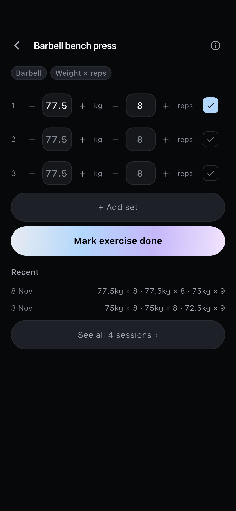
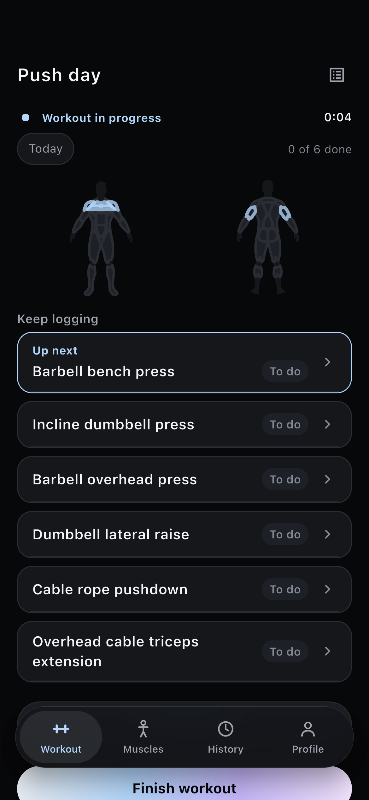
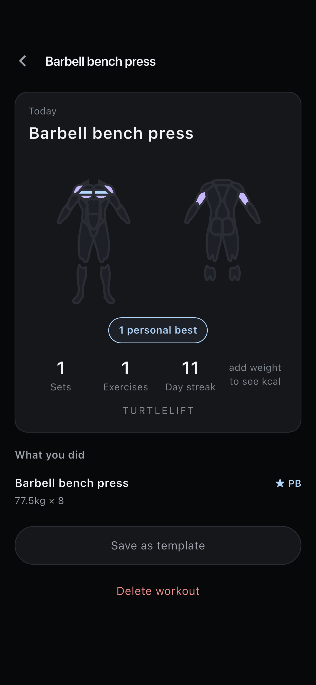
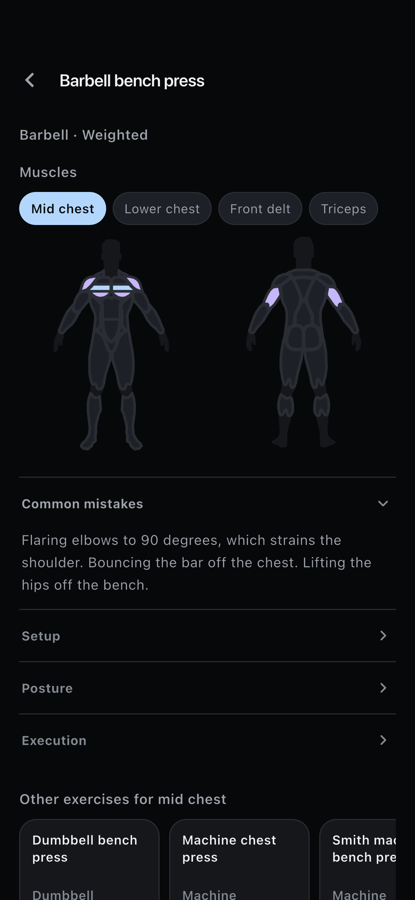
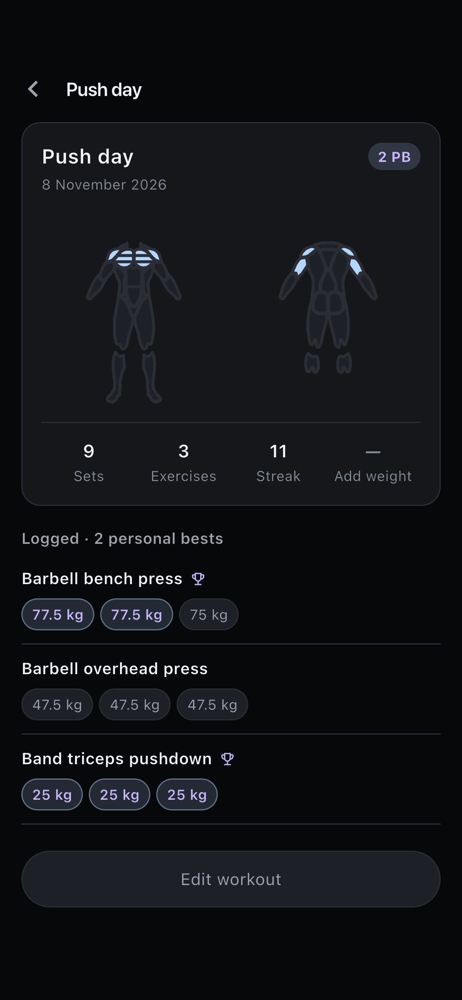
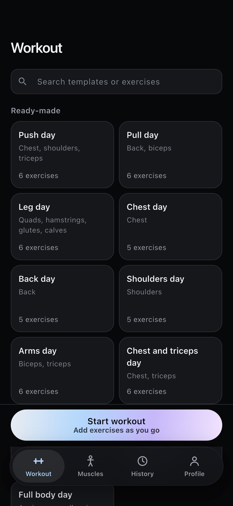

# Unslop audit and direction: TurtleLift

Audit and direction only, 2026-11-08. No app code, tests or docs were changed.
Per unslop step 4, nothing gets edited until you approve the direction below.

Audit method: unslop by Damir Sokolovsky (@heydamir), https://github.com/heydamir/unslop, CC BY 4.0.

- **App audited:** commit `1e7020a` ("Apply the ONE DAY theme and a production taste pass…", branch `taste-pass-production-polish`).
- **Screens:** shot fresh with `tool/taste_shots.sh`: 40 screens on iPhone 17e and 40 on iPhone 17 Pro Max. Both walks passed with nothing skipped. I looked at every PNG.
- **Sample shots:** 17e copies are in [`unslop-shots/`](unslop-shots/).
- **Capture gaps:** `08-exercise-picker-empty` and `27-search-empty` show result lists, not empty states, so the test never reaches them. `18-summary-bottom` is identical to `17-summary`. Empty states are therefore not audited here.

---

## Verdict

**Overall: light slop, with one heavy area, which is colour.**

The craft is mostly already there:
- Sentence case everywhere and no emoji.
- No hype words and no exclamation marks.
- Honest helper copy and real-looking sample data.
- No looping motion.
- A pinned header, and contrast that has been checked.

Almost all of the slop sits in one place, the colour system:
- An **ice→lilac hue gradient on every primary button**. This is the textbook unslop sign ("purple to blue gradients on buttons") and the element `theme-originality.md` says looks most copied.
- **Two accents spread over the chrome.** Lilac, which §12 reserves for the secondary muscle, also marks PBs, "In progress" and the body-map press state.
- **Primary and secondary muscle colours that nearly merge**, in normal vision as well as for colour-blind users.

Around that:
- Everything that isn't a card is a pill.
- 14 font sizes and a lot of weight 600/700.
- Off-grid spacing transcribed from the prototype CSS.
- No screen has a "moment". The body map should be one, but it renders as a murky grey figure with pale fills.

**How much to change.** By unslop's step 3 this is *polish mode*, which normally keeps the palette. Here the palette has to go anyway, for originality reasons, and it is itself the main slop. So the plan is:
- A **full Color pass** with a new palette.
- **Polish only** for spacing, icons, copy, type, details and motion.
- No change to layouts, features or section order.

| Screen (ranked by how often a user sees it) | Shots | Slop | Main signs |
|---|---|---|---|
| 1. Set logging | 10, 11, 16 | Light | Gradient "Mark exercise done"; three stacked full-width capsules; numbers are small for mid-set reading; steppers 34pt wide |
| 2. Live session (overview + list) | 04, 05, 15 | Light-moderate | Gradient Start logging / Finish; accent on strip text, dot, Up next border, label, Done tag; lilac "In progress"; six identical "To do" pills; map underpowered |
| 3. Exercise picker | 06, 07 | Light | An equipment pill on every row; filter chips fine |
| 4. Workout landing | 01–03 | Moderate | The gradient Start bar is the biggest coloured object in the app; 11 identical template tiles |
| 5. Summary card (the screenshot) | 17 | Moderate | No moment: small map, generic 4-stat row, "add weight to see kcal" sitting in a stat slot, accent-outlined pill, tracked-caps wordmark |
| 6. History (calendar, list, detail) | 28–31 | Moderate | Lilac PB pills and lilac PB set chips; trophy icon; three different PB treatments; mixed number formats |
| 7. Muscles tab | 20–24 | Light | Quiet, but the large map is a near-invisible grey silhouette, so the one visual has no presence |
| 8. Exercise detail / history | 12–14 | Light | Filled accent legend chip; ice vs lilac muscles indistinguishable; pills for every set |
| 9. Profile, Schedule, data screens | 32–40 | None to light | Gradient on Record and Export; 4pt input next to a capsule; otherwise clean |

---

## Direction

- **Product.** An offline lifting log you work one-thumbed between sets. It fills in a map of your muscles as you train and ends each session with a card worth keeping.
- **Character.** Steady, exact, quietly warm.
- **World.** The iron end of a gym: graphite plates and knurled steel, chalk on the hands and on the bar, a pencil logbook. The turtle's shell supplies the one warm colour.
- **Moments.** These are the only places on any screen where colour gets rich.
  1. **The body map**, where worked muscles warm to shell amber set by set, with secondary muscles in cool steel.
  2. **The summary card**, built around that same map at a large size, with the session's figures set big in tabular numerals, chalk on graphite, and composed to be screenshotted.
- **Signature (proposal; skip it if it feels like too much).** *Scutes.* Each completed set is drawn as a small hexagonal shell plate that fills amber, for example three plates with two filled on a session row. They echo the map segments filling in.
  - Where: only for completed-set counts, meaning the live session row, the summary's "What you did", and the history row.
  - It is not a badge, not an achievement, and not the mascot.

What this direction rules out: hue gradients, glow, glass as decoration, a second accent in the chrome, and colour anywhere except the two moments, the active tab, the selection and the PB figure.

---

## Palette proposal

**This is a spec change.** It touches `00` §12, `01` "Visual theme", `CLAUDE.md`, the `turtle-taste` skill and `test/theme_palette_test.dart`, so it needs your approval. The role names in `AppPalette` stay the same, so the swap is mechanical. `onAccent` equals `pageBackground` as it does today, so the closed set stays at 10 distinct values plus overlays. There is no gradient, and `AppGradients` is deleted.

**Why the neutrals are graphite.** Unslop's colour rule says app surfaces stay neutral, because people look at them for hours, and that the world shows in the accent and the moments. That rule is exactly why "Lagoon" failed: its blue-green surfaces read as a colour. Both options below use one graphite ramp with no tint and change only the accent pair.

### Recommended: Chalk & Shell

| Role | Hex | Notes |
|---|---|---|
| `pageBackground` | `#0E0E0F` | graphite, no tint |
| `surface` | `#18181A` | cards, sheets |
| `border` | `#2E2E32` | hairline, about 8% of chalk over surface |
| `mutedSurface` | `#222225` | raised controls; untrained map segment |
| `textPrimary` | `#EDEDEB` | chalk; also the **primary button fill** |
| `textSecondary` | `#A3A3A7` | |
| `textMuted` | `#8B8B90` | |
| `accentStrong` | `#FFA53D` | shell amber: trained muscle, active tab, selection, PB figure |
| `accentLight` | `#93ABCB` | steel, **secondary muscle only** |
| `onAccent` | `#0E0E0F` | equals page |
| `danger` | `#FF7A85` | destructive only; moved away from the current `#FF8A8A` |

- **Primary button: a chalk capsule** (`textPrimary` fill, `onAccent` label, 16.5:1, label weight 600), with no gradient. This is unslop's dark-theme suggestion, and here it does real work:
  - Amber leaves the buttons, so it means only *worked / active / record*, and the one-meaning rule gets stronger.
  - A chalk button reads as chalk, which is the world.
  - It has the highest possible contrast under gym lighting.
- **Cost of the chalk button:** §12 currently says `accentStrong` = "primary action", and `turtle-taste` says "exactly one filled (liquid) button". Both rules have to be rewritten as "primary action = chalk fill; amber = trained / active / PB".
- **Disabled button:** `mutedSurface` with `textMuted`, as today.
- **Amber filled button:** rejected. It would put the strongest colour in the app on the chrome of every screen, competing with the map, which is the slop pattern this pass removes.
- **Originality:**
  - Amber on graphite is TurtleLift's own lineage: the original prototype palette was warm coral `#D85A30`, and the "Shell" option in `theme-originality.md` was amber.
  - It is moved onto neutral surfaces so it does not read as a brown app.
  - None of the 11 values match ONE DAY.
  - Steel for the secondary muscle puts primary and secondary on the blue–yellow axis, which red-green colour blindness keeps.

### Alternative: Chalk & Moss

Same graphite ramp and chalk button. Only these three change:

| Role | Hex |
|---|---|
| `accentStrong` | `#9CCB78` (moss, "turtle green") |
| `accentLight` | `#8EA2D0` (slate, secondary muscle only) |
| `danger` | `#FF85B3` (rose; a red danger merges with moss for deuteranopes, ΔE 7.1) |

- **Upside:** green reads naturally as "worked / done".
- **Downsides:**
  - Danger has to go rose-pink, which is less conventional.
  - Moss and slate merge for tritanopes (ΔE 14.7). Tritanopia is rare, but it is a gap.
  - Green-for-done is also what every habit app does.
- I recommend Shell.

### Contrast (WCAG 2.x, computed)

Computed with the scratchpad script (`contrast.py`, extended as `pal2.py`). Targets:
- `textPrimary` at least 7:1.
- Secondary and muted text at least 4.5:1.
- `onAccent` on accent at least 4.5:1.
- Map fills on `mutedSurface` at least 3:1 (non-text, WCAG 1.4.11).

| Check | Current (ONE DAY) | Chalk & Shell | Chalk & Moss |
|---|---|---|---|
| textPrimary / page | 18.18 | 16.46 | 16.46 |
| textPrimary / surface | 16.27 | 15.13 | 15.13 |
| textSecondary / page | 7.92 | 7.68 | 7.68 |
| textSecondary / surface | 7.09 | 7.05 | 7.05 |
| textSecondary / mutedSurface | n/a | 6.31 | 6.31 |
| textMuted / page | 5.75 | 5.69 | 5.69 |
| textMuted / surface | 5.15 | 5.23 | 5.23 |
| textMuted / mutedSurface | 4.68 | 4.68 | 4.68 |
| Primary button label on fill | gradient (varies) | 16.46 (chalk) | 16.46 (chalk) |
| onAccent / accentStrong (Done tag, ticked set) | 13.31 | 9.83 | 10.32 |
| accentStrong / mutedSurface (trained segment) | 10.83 | 8.09 | 8.48 |
| accentLight / mutedSurface (secondary segment) | 9.02 | 6.75 | 6.22 |
| danger / page | n/a | 7.69 | 8.51 |
| danger / surface | 7.90 | 7.07 | 7.82 |

Every check passes in both options.

### Primary vs secondary muscle under colour blindness

ΔE CIE76 after Machado 2009 full-severity simulation; higher is better, and below about 15 the two colours look nearly the same.

| | Current ice / lilac | Shell amber / steel | Moss / slate |
|---|---|---|---|
| Normal vision | 29.8 | **87.6** | 71.5 |
| Deuteranopia | **9.3** (merges) | **85.9** | 61.9 |
| Protanopia | 15.2 | **81.6** | 67.5 |
| Tritanopia | 27.2 | **61.8** | 14.7 |

Amber vs danger (Shell) is 53.6 / 41.9 / 56.3 / 19.3. Danger always comes with a word, never appears on the map, and no longer shares the button with the accent, so this is enough.

**The body silhouette itself also needs help.** Untrained segments (`mutedSurface`) sit at about 1.2:1 against the page today and would in the new palette too. That is why the Muscles-tab map reads as a shadow (shot 20).
- Fix in the painter, not with a new colour: stroke each segment with `border`.
- On the Muscles tab, consider filling untrained segments with `border` instead of `mutedSurface`.
- This is a `00` §5 wording change ("untrained `#1D2027`").

---

## Audit by sign

One line per sign: **sign**, screen (shot name), where in code. Paths are under `lib/src/`.

### Surfaces and colour
- **Hue gradient on buttons (ice→lilac).** Shots 01, 02, 03 Start workout; 04 Start logging; 05 / 15 Finish workout; 11 Mark exercise done; 34 Record; 36 Export. Code: `theme/app_theme.dart:137` (`backgroundBuilder: _liquidBackground`), `:215-228`; `theme/app_palette.dart:60-73`; `ui/personal_details_screen.dart:278`.
- **Every element highlighted: a second accent (lilac) in the chrome.**
  - PB pills: 28, 31, `ui/history_session_row.dart:179`; 29, `ui/history_session_detail_screen.dart:235`.
  - PB set chips: 29, `history_session_detail_screen.dart:474`.
  - Trophy: 29, `:425`.
  - "In progress" tag: 15, `ui/session_overview_body.dart:438`.
  - Map press highlight: `ui/body_diagram.dart:184`.
  - All of this breaks §12 ("secondary muscle only").
- **Accent used five times on one screen.** Shot 05: strip dot and text (`session_overview_body.dart:190`, `:227`, `:236`), Up next border and label (`:352`, `:372`), Done tag fill (`:435`), active tab, and the gradient Finish.
- **Accent-outlined "glowing pill".** 17 "1 personal best": `ui/session_summary_screen.dart:334-342`.
- **Filled accent chip that is not the action.** 12 / 24 "Mid chest" legend chip: `ui/exercise_detail_screen.dart:551-554`.
- **Near-identical tints doing different jobs.** Ice vs lilac on every map (12, 15, 17, 29): luminance ratio 1.20, deuteranopia ΔE 9.3. `app_palette.dart:39`, `:43`.
- **Glass.** The floating tab bar uses backdrop blur and a drop shadow, on every tab root. `ui/glass_tab_bar.dart:303-380`. Kept; see Conflicts.
- **Neutrals slightly blue-tinted** (`#07080A` / `#15171C` / `#1D2027`). `app_palette.dart:11-25`. Minor.

### Type
- **Weight 700.** 10 sites:
  - Button label: `theme/app_theme.dart:135`.
  - `ui/disclosure_row.dart:134`, `:141` (Common mistakes / Setup headings).
  - `ui/session_overview_body.dart:189`, `:371`.
  - `ui/history_session_row.dart:178`.
  - `ui/history_session_detail_screen.dart:234`.
  - `ui/history_calendar_card.dart:144`, `:383`, `:469`.
- **Weight 600 used 54 times**, so it is not "rare emphasis".
- **Too many sizes.** 14 distinct sizes across `ui/`: 12, 12.5, 13, 13.5, 14, 14.5, 15, 16, 17, 18, 19, 20, 22, 24. The half-points are transcribed prototype CSS, for example `theme/app_theme.dart:149`, `:153` (13 / 11 padding, 13.5 hint) and `ui/set_row.dart:281` (12.5).
- **Negative tracking on small text.**
  - −0.1 at 13–15pt: `ui/template_row.dart:103`, `ui/sub_group_row.dart:136`, `ui/profile_screen.dart:291`, `:301`, `ui/muscles_root.dart:250`, `ui/history_session_row.dart:80`, `ui/schedule_pane.dart:757`.
  - −0.2: `ui/template_preview_sheet.dart:73`, `ui/exercise_picker_sheet.dart:134`.
  - −0.4: `ui/schedule_pane.dart:297`.
  - −0.16 at 16pt: `ui/app_screen.dart:152`.
- **Uppercase tracked label.** 17 "TURTLELIFT" wordmark, `ui/session_summary_screen.dart:360-363`. This is the repo's one allowed exception; see Conflicts.
- **Numbers in mixed formats.**
  - `77.5kg × 8` (04, 11, 14, 17, `data/set_format.dart:24-63`)
  - vs `77.5 kg` (29, `ui/history_session_detail_screen.dart:469-470`; `ui/personal_details_screen.dart:318`)
  - vs `Last 75kg × 9` (06).
- **Tabular figures:** only 7 uses in `lib/`, so most changing numbers (set values in Recent, summary figures, calendar, export counts) are proportional.

### Icons
- **Three treatments for one concept (PB):**
  - `★ PB` text glyph: 14, 17, `ui/exercise_history_screen.dart:201-202`, `ui/session_summary_screen.dart:556-557`.
  - Trophy icon: 29, `ui/history_session_detail_screen.dart:423`.
  - Lilac "2 PB" pill: 28, `ui/history_session_row.dart:157-186`.
  - The trophy also reads as an achievement, which `CLAUDE.md` rules out.
- **Text glyphs standing in for icons.**
  - "+ " prefixes: 10, 15, 16, `ui/set_logging_screen.dart:105`, `ui/session_overview_body.dart:487`, `ui/set_row.dart:280`.
  - "›" chevrons inside buttons: 10, 28, 14, `ui/set_logging_screen.dart:306`, `ui/history_root.dart:95`, `ui/exercise_history_screen.dart:258`.
  - Elsewhere the app uses Material chevron icons, so these sit next to real icons.
- **Unclear pictogram.** 28 / 31: the session-row `MuscleGlyph` reads as a jar at 24pt. `ui/history_session_row.dart:222-298`. Minor.
- No emoji anywhere. Icons are otherwise one set at a consistent size.

### Spacing
- **Off-grid values.** 43 paddings or sizes at 3, 5, 7, 9, 10, 11, 13, 14, 18, 19 or 22 in `ui/`. Examples: input padding 13 / 11 (`theme/app_theme.dart:149`), set-number column 18 (`ui/set_row.dart:142`).
  - Repo values on a 2pt step (10, 14, 18) are a deliberate prototype match.
  - Unslop asks for a 4pt grid, with 2pt nudges only inside small controls.
- **Stepper tap targets 34×48** (10, 11): `ui/stepper_field.dart:249-251`. This fails turtle-taste's 48pt rule too.
- **Uneven row heights in one list.** 06 / 07 picker: a row with "Last 75kg × 9" is a third taller than its neighbours, because the equipment pill and the last-set line stack.
- **Big empty band under the content on Pro Max** (set logging 10 / 11, profile 32, schedule 39). It is not a bug, but on the big phone the set rows, the one thing this screen is for, use a third of the height.

### Copy
- **An instruction placed in a figure slot.**
  - 17: "add weight\nto see kcal", lowercase, inside the stats row. `ui/session_summary_screen.dart:425`.
  - 29: "— / Add weight". `ui/history_session_detail_screen.dart:291`.
- **Redundant kind badge on every row.** 26: "Exercise" / "Equipment" pills. `ui/muscle_search_screen.dart:26-32`.
- **Question headline for a sheet** ("What are you starting with?", 06, `ui/session_overview_body.dart:156`). Mild. "Add exercises" names the action.
- **Clean otherwise:** no exclamation marks, no greetings, no hype, no trailing periods on labels, plausible data.
- **Exercise content** (`setup` / `posture` / `execution` / `commonMistakes`) was not reviewed for style and must not be touched.

### Components
- **Everything is a pill.** Counted: 20 `circular(999)` and 23 `StadiumBorder`. Buttons and chips are capsules by repo rule. These are also pills, and they are neither buttons nor chips:
  - status tags "To do" / "In progress" / "Done" (05, 15)
  - the date "Today" (04, 05)
  - PB counts (28, 29)
  - set-history chips (14, 29)
  - kind badges (26)
  - equipment tags on every list row (06, 22, 23)
  - "Weight × reps" / "Barbell" tags (10)
- **Equal cards side by side.** 01 / 02: 11 template tiles with identical layout, and only the text differs. The two-column grid is spec'd (`00` §9), so this is noted, not a fix.
- **Stat row with a filler cell.** 17 / 29: Sets, Exercises, Streak, plus a non-figure fourth cell.
- **Three stacked full-width capsules on one screen.**
  - 10: + Add set, Mark exercise done, See all 4 sessions.
  - 15: + Add exercise, Finish, Discard.
- **Radius drift.**
  - Weight input uses the default 4pt (`ui/personal_details_screen.dart:249-257`) next to a capsule Record button (34).
  - Search field is 12 (`theme/app_theme.dart:206`) against the 16 card scale.

### Visuals
- **The one moment is underpowered.** The body map is the product's own visual, but:
  - untrained segments are about 1.2:1 against the page (20, 22)
  - trained fills are pale and small on the live screen (05, 15) and on the summary (17).
  - Nothing else on any screen is a moment.
- No decorative filler, blobs or generated images. Correct for an app, so nothing to remove.

### Motion
- **Overshoot.** `ui/finish_celebration.dart:49` (`Curves.easeOutBack`).
- **Animating layout properties.** The ring grows by width / height (`ui/finish_celebration.dart:56-57`).
- **Durations without a system:** 70, 90, 140, 150, 160, 220, 260, 450, 850, 900 ms, with no single curve. Most are in the tab bar, which deliberately mimics iOS.
- Good as is: one-shot pulse, not a loop (`ui/session_overview_body.dart:202-217`); reduced motion honoured in the tab bar.

### Template-look risk after the fix
Once the gradient goes, the app risks unslop's "pure grey page, white text, brand colour on one button" fallback. The direction answers that with three things:
- amber only on the map and the PB figure
- a chalk button rather than an accent button
- the scute signature.

Run unslop's template check after the Color pass: swap the name for another workout app, and the summary card should no longer fit.

---

## Conflicts with repo rules, and which wins

Repo rules outrank unslop. Each line gives the resolution.

| Unslop says | Repo says | Resolution |
|---|---|---|
| Weights 400–500, 600 rarely; no 700 | `turtle-taste`: section labels "13pt semibold"; `app_theme.dart:135` uses w700 button labels | **Repo wins on labels (600).** Propose dropping every w700 to 600 and using 500 for row titles. Both rules allow that, so no rule change is needed. |
| "Not everything is a pill"; radius by size | `CLAUDE.md`: "one radius scale (16 cards, capsule buttons and chips)" | **Repo wins for buttons and chips.** Status tags, PB counts, set chips, kind badges, the date and equipment tags are neither, so they become quiet text. That cuts the pill count without touching the rule. |
| Choose a typeface for the character | `CLAUDE.md`: typeface undecided; Inter must be bundled; "do not bundle it without asking" | **Repo wins: ask.** See Questions. Platform SF Pro is a defensible choice here, not "Inter nobody chose". |
| Primary button can be off-white on dark | §12: `accentStrong` = "primary action"; `turtle-taste`: "exactly one filled (liquid) button" | **Needs your approval.** It is a rule change inside the palette spec change. |
| New palette and accent from the world | Closed palette (`00` §12, `theme_palette_test.dart`): a new colour is a spec change | **Needs your approval.** All palette work is proposal-only until then. |
| No glass trend | Glass tab bar chosen from `prototypes/l0-tabbar-prototype.html`; matches iOS 26 | **Repo wins: keep.** It is platform convention, it uses a neutral shadow, and no hue. |
| Logo is the name in the main family, no tracked caps | `turtle-taste`: "The only caps in the app is the summary card's wordmark" | **Repo wins.** Sentence-case "TurtleLift" is offered as an option in Questions. |
| Copy pass rewrites anything vague | Exercise content is reviewed injury-risk copy | **Repo wins absolutely.** `setup` / `posture` / `execution` / `commonMistakes` are excluded from every pass. |
| Moments, visuals, mascot-like objects | Mascot is last, undecided, never on the share card | **Repo wins.** The direction uses the body map, not the mascot. Scutes are a data mark, not a character. |
| Layout pass may re-proportion sections | Prototype wins on layout; spec fixes set-logging order and the landing grid | **Repo wins.** Only proportions inside a section move: number size, row heights, map size. No reordering. |
| Remove decoration, add nothing | No achievements, badges or level-ups | **Agrees.** It is the reason the trophy goes. |

---

## Proposed plan, pass by pass

**Proposals only. Nothing is applied before you approve.** All nine passes apply. Theme-level first, then shared widgets, then screens, per `turtle-taste` §5. Paths are under `lib/src/` unless stated.

### 1. Spacing
- Snap off-grid values to the 4pt scale, keeping 2pt nudges inside small controls only.
  - `theme/app_theme.dart:149`: 13 / 11 → 12 / 12.
  - `ui/set_row.dart`, `ui/stepper_field.dart`, `ui/history_session_row.dart`, `ui/disclosure_row.dart`, `ui/template_row.dart`: 3, 5, 7, 9, 11, 13, 19 → nearest step.
- Steppers to 48×48 (`ui/stepper_field.dart:249-251`). On the 17e that probably means moving the "kg" / "reps" units inside the field as a suffix to win back the width. Check it on the 17e and at 1.3× text.
- One row height per list. In the picker, put equipment and the last set on one muted line, so every row is the same height (`ui/exercise_picker_sheet.dart`).

### 2. Colour
- Swap the values in `theme/app_palette.dart` and rewrite its comments, dropping every ONE DAY reference.
- Delete `AppGradients`, and remove `_liquidBackground` and its use (`theme/app_theme.dart:137`, `:215-228`, `ui/personal_details_screen.dart:278`).
- Primary button: `backgroundColor: textPrimary`, `foregroundColor: onAccent`.
- Take lilac out of the chrome:
  - **PB** becomes one treatment: the word "PB" in amber, weight 600, no pill (`ui/history_session_row.dart:157-186`, `ui/history_session_detail_screen.dart:229-240`, `:423-425`, `:474`, `ui/exercise_history_screen.dart:201`, `ui/session_summary_screen.dart:556`).
  - **"In progress"** becomes muted text (`ui/session_overview_body.dart:438`).
  - **Map press state** becomes a chalk outline, not a fill (`ui/body_diagram.dart:184`).
- Live session: the strip text goes to `textSecondary`, keeping only the dot amber. Up next keeps the amber label but drops the amber border for a `border` hairline (`ui/session_overview_body.dart:190`, `:227`, `:236`, `:352`).
- Summary: "1 personal best" becomes an amber figure in the stats row, not an outlined pill (`ui/session_summary_screen.dart:330-345`).
- Body map: stroke segments in `border` so the figure reads (`ui/body_diagram.dart` painter).
- Docs and tests, using the swap checklist already in `docs/research/theme-originality.md` §5:
  - `00` §5 fill colours and §12
  - `01` Visual theme
  - `CLAUDE.md` palette bullets
  - `turtle-taste` rules ("liquid gradient" becomes "no gradients"; "primary action = chalk")
  - `test/theme_palette_test.dart` comment
  - delete `docs/one-day-theme-reference.md`
  - an ADR in `docs/adr/` recording the change.

### 3. Icons
- Replace the "+ " prefixes and "›" chevrons with `Icons.add_rounded` / `Icons.chevron_right_rounded`, one size, in the label colour.
  - `ui/set_logging_screen.dart:105`, `:306`
  - `ui/session_overview_body.dart:487`
  - `ui/set_row.dart:280`
  - `ui/history_root.dart:95`
  - `ui/exercise_history_screen.dart:258`
- Delete the trophy (`ui/history_session_detail_screen.dart:423`).
- Signature, if approved: one `ScuteRow` widget, painted with `CustomPainter`, used only for completed-set counts in `ui/session_overview_body.dart` (replacing the "To do" pills), `ui/session_summary_screen.dart` "What you did", and `ui/history_session_row.dart`.

### 4. Copy
- **Summary and history stats:** when there is no bodyweight, drop the kcal cell and put one muted line under the row: "Add your bodyweight in Profile to see kcal". Files: `ui/session_summary_screen.dart:425`, `ui/history_session_detail_screen.dart:291`.
- **Weight format:** one format everywhere, `77.5 kg × 8` (with a space). This needs `data/set_format.dart:24-63` and `ui/history_session_detail_screen.dart:469`. Check `test/` for string expectations first.
- **Kind badges:** drop the "Exercise" / "Equipment" badges and group results under headings instead (`ui/muscle_search_screen.dart:26-32`).
- **Picker sheet title:** "What are you starting with?" → "Add exercises" (optional) (`ui/session_overview_body.dart:156`).
- **Exercise content:** untouched.

### 5. Type
- Remove all w700 (the 10 sites above) in favour of 600. Row titles go to 500, and 600 is left for screen titles, section labels and the button label.
- Collapse to one scale: 12 / 13 / 15 / 17 / 20 / 24, plus the fitted set-logging numeral.
  - Delete 12.5, 13.5, 14, 14.5, 16, 18, 19 and 22.
  - Put the scale in `theme/app_typography.dart` so screens stop writing literals.
- Zero tracking below 16pt (the −0.1 / −0.2 / −0.4 sites above). Keep the display tracking on the 24pt tab title (`ui/app_screen.dart:146`).
- `FontFeature.tabularFigures()` on every changing or aligned number: Recent, summary and history figures, the calendar, export counts and set chips.
- Typeface: see Questions. Nothing is bundled without your answer.

### 6. Layout
Proportions only; no order changes.
- **Set logging (10, 11, 16):** make the set rows the biggest thing on screen, because they answer "what do I lift now?".
  - Taller fields, with the numeral at about 24–28 instead of about 17.
  - 48pt steppers.
  - Secondary actions ("+ Add set", "See all N sessions") become text buttons instead of full-width capsules, so the only capsule left is the chalk "Mark exercise done".
- **Live session (05, 15):** the map is the hero and one step larger. Rows lose the trailing status pill (replaced by scutes, or by "2 of 3 sets" in muted text).
- **Summary card (17):** composed for the screenshot.
  - The map at the full card width.
  - Three figures in one row in big tabular numerals, with PB as an amber figure among them.
  - The date and title above, and the wordmark at the foot.
- **Workout landing (01):** keep the spec'd grid. Optionally show the template's muscles with the existing `MuscleGlyph`, so tiles differ by content rather than only by text. This is a suggestion, not a fix.

### 7. Details
- Turn non-button, non-chip pills into quiet muted text: status tags, the date, PB counts, set-history chips (shown as a muted inline list, `77.5 · 77.5 · 75 kg`), kind badges and equipment tags.
- Exercise-detail legend chips (`ui/exercise_detail_screen.dart:551`) become a coloured dot plus the label, not a filled chip.
- Radius:
  - weight input → 16 (`ui/personal_details_screen.dart:249-257`)
  - search field → 16 (`theme/app_theme.dart:206`)
  - nested radius inside the Up next card.

### 8. Visuals
- No generated images. The body map is the visual. Its fixes are listed under Colour and Layout: segment strokes, a larger summary map, and amber / steel fills that separate.
- Empty states stay mascot-free until the mascot is settled. Before that, extend `integration_test/taste_shots_test.dart` so `08` and `27` actually reach their empty states.

### 9. Motion
- `ui/finish_celebration.dart`: `easeOutBack` → `Cubic(0.22, 1, 0.36, 1)`, and grow the ring with `Transform.scale` instead of width and height.
- Add a shared curve and three durations (150 / 250 / 400 ms) to a theme file for new motion.
- Leave the tab bar's iOS-matched timings alone.

**Gate after the edit:** `flutter analyze`, `flutter test`, then `tool/taste_shots.sh` (plus the 1.3× large-text run on the 17e), and a before/after pass against this audit list.

---

## Questions for you

1. **Palette.** Approve **Chalk & Shell** (amber `#FFA53D` / steel `#93ABCB` on graphite), the alternative **Chalk & Moss**, or neither? Both are spec changes to §12, `01`, `CLAUDE.md` and the palette test.
2. **Chalk primary button.** Are you OK moving the primary action off the accent (a chalk capsule with dark text), which rewrites "accentStrong = primary action"? Or do you want an amber filled button?
3. **Typeface.** Unslop wants a deliberate choice; the repo says ask. The options:
   - (a) keep the platform face (SF Pro / Roboto), the zero-cost choice and an honest one
   - (b) bundle one interface family, for example IBM Plex Sans or Geist, as an asset
   - (c) keep the platform face and bundle only a figures face, for example IBM Plex Mono or Geist Mono, for set numbers and summary figures.

   My lean is (a) or (c).
4. **Signature.** Do you want the scutes (hexagonal shell plates as the completed-set mark), or should I skip a signature for now?
5. **Wordmark.** Keep "TURTLELIFT" in tracked caps (the repo's one exception), or set it as "TurtleLift" in sentence case like everything else?
6. **Set-row width.** Are you OK moving "kg" / "reps" inside the number fields so the steppers can reach 48pt on the 17e?
7. **Glass tab bar.** Keep it as is (my recommendation, since it is platform convention), or make it solid to match the "no glass" stance?
8. **Separate from design, from `theme-originality.md`:** do you have ONE DAY's author's permission in writing? It changes how urgently the ONE DAY references in docs and comments need to go. They go in the Colour pass either way.
